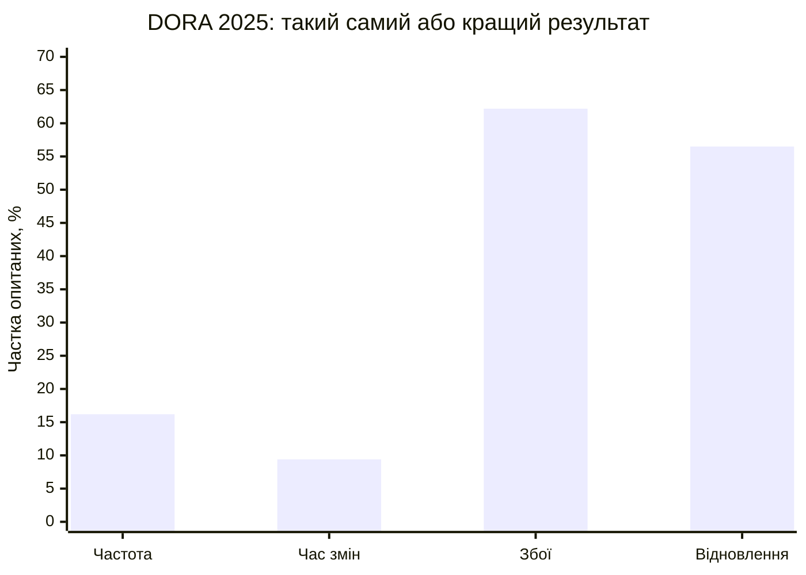

# DORA-метрики CI/CD

## Період і джерело

- **Період:** 2026-10-30 — 2026-11-13 включно, 15 календарних днів.
- **Джерело:** повний набір із 60 одиниць постачання у [metrics-raw.md](metrics-raw.md).
- **Одиниця:** один merge-коміт запиту на злиття у `main`, перевірений робочими процесами `CI` і `Deploy API docs`.
- **Замінник розгортання:** окремої автоматичної події розгортання у виробниче середовище в GitHub Actions немає, тому для цієї лабораторної розгортання означає merge у `main` із подальшими автоматичними робочими процесами.

## Підсумок

| Метрика DORA | Результат | Формула | Категорія DORA 2025 |
|---|---:|---|---|
| Частота розгортань | **3,2 на день** або **22,4 на тиждень** | 48 зелених / 15 днів | На вимогу, кілька разів на день — **16,2%** опитаних мають такий або кращий результат |
| Час виконання змін | **24 хв 23 с** (медіана), **2 год 25 хв 27 с** (середнє) | `завершення − перший коміт` для 48 зелених одиниць | Менше години — **9,4%** мають такий або кращий результат |
| Частота збоїв змін | **14,3%** | 8 червоних / (48 зелених + 8 червоних) | 8–16% — **62,2%** мають такий або кращий результат |
| Час відновлення після невдалого розгортання | **6 год 2 хв 47 с** (медіана), **6 год 23 хв 58 с** (середнє) | інтервал від кожної з 8 червоних одиниць до наступної зеленої | Менше доби — **56,5%** мають такий або кращий результат |

## 1. Частота розгортань

За період у `main` потрапило 60 комітів злиття. За визначенням лабораторної розгортанням є лише одиниця, у якій зелені обидва враховані робочі процеси `CI` і `Deploy API docs`. Таких одиниць було 48:

```text
48 / 15 = 3,2 розгортання на день
48 / (15 / 7) = 22,4 розгортання на тиждень
```

Результат показує часті невеликі інтеграції. Водночас це частота одиниць постачання у `main`, а не підтверджена частота оновлення виробничого сервера.

## 2. Час виконання змін

Для кожного з 48 зелених запитів на злиття виміряно час від його першого коміту до завершення останнього завдання врахованої одиниці.

| Статистика | Значення |
|---|---:|
| Медіана | **24 хв 23 с** |
| Середнє | **2 год 25 хв 27 с** |
| P75 | 1 год 6 хв 33 с |
| Мінімум | 3 хв 54 с |
| Максимум | 1 день 7 год 58 хв 29 с |

Медіана значно менша за середнє, отже розподіл має довгий правий хвіст: більшість змін проходить швидко, але кілька запитів довго очікували злиття або завершення робочого процесу. Для базового рівня команди доцільніше використовувати медіану та P75, а не лише середнє.

### Частка черги та виконання

Для 48 зелених одиниць сумарний час виконання змін становив 4 дні 20 год 21 хв 29 с.

| Складова | Сумарний час | Частка від повного часу зміни | Частка всередині CI |
|---|---:|---:|---:|
| Очікування до створення запуску: робота з PR, огляд і злиття | 4 дні 16 год 27 хв 59 с | **96,66%** | — |
| Черга на раннер | 40 хв 29 с | **0,58%** | **17,34%** |
| Виконання завдань | 3 год 13 хв 1 с | **2,76%** | **82,66%** |

Вузьке місце не в черзі раннера: найбільшу частину повного часу зміни становить очікування до запуску CI. Усередині самого CI черга займає 17,34%, а виконання — 82,66%.

## 3. Частка невдалих змін

Основний розрахунок не зараховує скасовані через обмеження одночасності запуски як помилки коду:

```text
Частка невдалих змін = 8 / (48 + 8) × 100% = 14,3%
```

Консервативна верхня межа, якщо вважати всі 4 скасовані запуски невдалими одиницями постачання:

```text
Консервативне значення = (8 + 4) / 60 × 100% = 20,0%
```

Для основної DORA-метрики використовуємо **14,3%**, а 20,0% залишаємо як перевірку чутливості. Усі вісім помилок належать до однієї серії падінь `Deploy API docs` 30 жовтня.

## 4. Час відновлення після невдалого розгортання

Для кожної з 8 червоних одиниць виміряно час до першої наступної зеленої одиниці. Усі вони відновилися завершенням запиту #231 о 15:41:20 UTC.

```text
Медіана = 6 год 2 хв 47 с
Середнє = 6 год 23 хв 58 с
Мінімум = 1 год 43 хв 38 с
Максимум = 15 год 38 хв 33 с
```

Це **час відновлення конвеєра постачання**, а не підтверджений час відновлення виробничого сервісу: наявні дані фіксують відмову генерації API-документації, а не збій виробничого сервісу.

## Порівняння з DORA 2025 та графік

Лабораторна робота вимагає чотири метрики. Відсотки нижче показують частку майже 5 000 опитаних DORA 2025, які мають такий самий або кращий результат. Джерело діапазонів — [Lab 10: Етап 2](https://ssdm-2026.cs-courses.org/labs/lab10/lab10.html).



Графік показує, що метрики швидкості кращі за метрики стабільності: лише 9,4% опитаних мають такий або кращий час виконання змін, але 62,2% мають таку саму або нижчу частоту збоїв.

## Аналіз метрик парами

- **Швидкість:** 22,4 зеленого розгортання на тиждень у поєднанні з медіаною 24 хв 23 с показують, що типова зміна доходить до зеленого стану швидко.
- **Стабільність:** частота збоїв 14,3% і медіана відновлення 6 год 2 хв 47 с показують, що після збою команда відновлюється значно повільніше, ніж доставляє типову зміну.
- **Спільний висновок:** висока швидкість не супроводжується такою самою сильною стабільністю. Одна повторювана помилка робочого процесу документації створила вісім червоних одиниць і погіршила обидві метрики стабільності.

## Який біль у нашій команді показали ці метрики?

Головний біль — повторення однієї й тієї самої помилки після злиття. `CI` був зеленим, але `Deploy API docs` вісім разів падав через відсутню залежність Pillow. Це показує, що за загальним зеленим `CI` команда не одразу помічала, що врахована одиниця постачання залишалася червоною. Черга раннера не є головною проблемою: 96,66% часу зміни минуло до старту CI.

## Інтерпретація базового рівня

- Зелені розгортання часті: у середньому 3,2 на день.
- Типова зміна доходить до завершення конвеєра за 24 хв 23 с.
- Частку невдалих змін погіршила одна повторювана конфігураційна помилка залежностей, а не вісім незалежних дефектів.
- Час відновлення завеликий відносно медіанного часу виконання зміни, бо однакова помилка повторювалася в кількох злиттях до виправлення.
- Щоб цей тип збою можна було заблокувати до злиття, перевірку складання API-документації слід запускати для запитів на злиття та зробити обов'язковою; її залежності слід встановлювати з файлу зафіксованих залежностей.

> ### Нотатка «Використання ШІ»
> - **Інструменти:** Codex.
> - **Етап:** розрахунок та інтерпретація чотирьох DORA-метрик, аналіз парами та побудова графіка.
> - **Що згенеровано:** формули, агрегати, перевірка чутливості для скасованих запусків, порівняння з DORA 2025, Mermaid-графік і початкові висновки.
> - **Що перевірено / відкинуто вручну:** усі значення перераховано з повної таблиці `metrics-raw.md`; категорії звірено з таблицею DORA 2025 в Lab 10; розгортання і час відновлення обмежено коректними замінниками, без твердження про автоматичне розгортання або збій у виробничому середовищі; п’яту метрику DORA не додано, бо вона не входить до завдання цієї лабораторної.

## Бонус: пошук нестабільних тестів

Workflow [`Flaky test detector`](../../.github/workflows/flaky-tests.yml) запускається лише вручну через `workflow_dispatch`. В одному job він п’ять разів послідовно виконує повний набір тестів на тому самому commit SHA, зберігає JUnit-звіт кожного повтору та формує таблицю тестів, результат яких відрізняється між запусками. Matrix strategy не використовується.

Локальна перевірка detector workflow після виправлення дала однаковий результат у всіх п’яти повторах: **600 passed, 28 skipped**. Окремий аналіз історії виявив нестабільний `TP-N02 / PERF-001`: один і той самий SHA спочатку впав із `p95 = 352,35 мс`, а при повторі пройшов із `p95 = 146,59 мс`, за обох спроб маючи 0% HTTP-помилок.

Тест виправлено без послаблення порога 300 мс: після трьох warm-up запитів він виконує три незалежні раунди по 50 конкурентних запитів і приймає рішення за медіаною round p95. Один шумний раунд shared runner більше не визначає результат, але два повільні раунди з трьох усе ще валять перевірку. Regression-тест перевіряє обидва сценарії; 10 повторів виправленого performance-тесту пройшли стабільно.

Окремий issue не створювався: вимога про issue стосується карантину, а знайдений нестабільний тест виправлено без вимкнення чи пропуску.

Рекомендована в завданні вибірка `gh run list --branch main` за період Етапу 1, 30 жовтня — 13 листопада, не містить зелених повторів без зміни коду: єдиний `attempt > 1` завершився `failure → cancelled`. Додатково у PR-гілках 16–17 листопада знайдено чотири `Performance benchmark`, які стали зеленими після повтору того самого SHA; саме вони допомогли знайти нестабільність. Повна вибірка зі спробами, логами та посиланнями наведена у [звіті про повторні запуски](evidence/flaky-main-reruns.md).

Після злиття workflow потрібно один раз запустити вручну з `main` і додати сюди пряме посилання на цей run як фінальний доказ виконання в GitHub Actions.

> ### Нотатка «Використання ШІ»
> - **Інструмент:** Codex.
> - **Етап:** реалізація й перевірка бонусного детектора нестабільних тестів.
> - **Що згенеровано:** початкова версія workflow, Python-аналізатора JUnit-звітів, модульних тестів і документації.
> - **Що перевірено вручну:** workflow має лише `workflow_dispatch`, один job і п’ять послідовних повних прогонів; модульні тести, black, flake8 і traceability check пройшли; повний набір тестів виконано п’ять разів із однаковим зеленим результатом; виправлений `TP-N02 / PERF-001` окремо виконано 10 разів без зміни результату.
