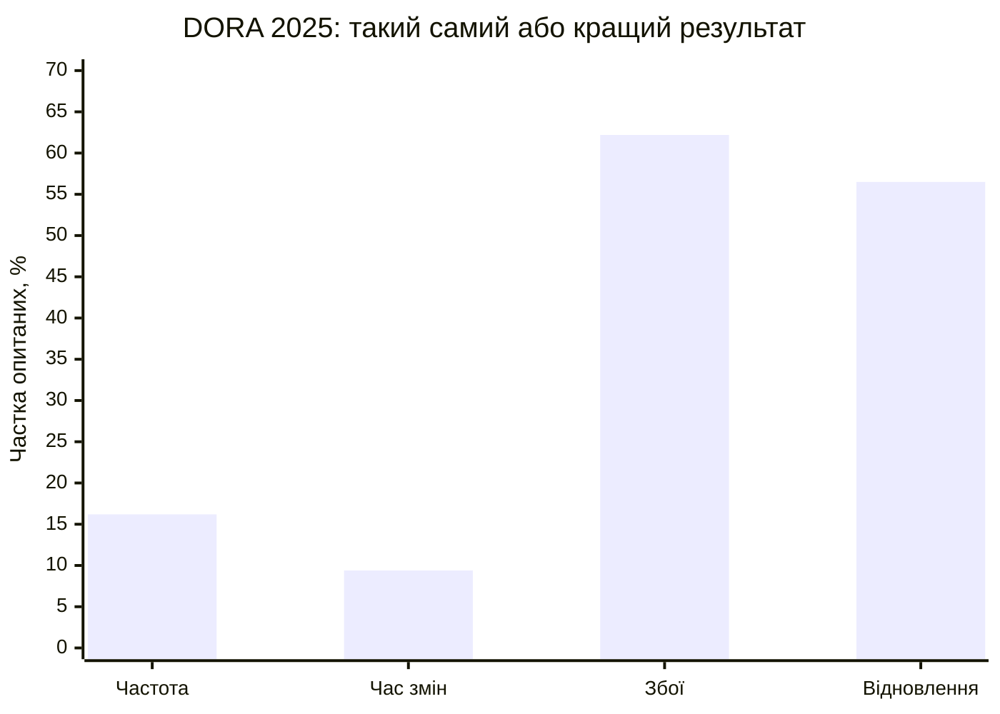

# DORA-метрики CI/CD

## Період і джерело

- **Період:** 2026-10-30 — 2026-11-13 включно, 15 календарних днів.
- **Джерело:** повний набір із 60 одиниць постачання у [metrics-raw.md](metrics-raw.md).
- **Одиниця:** один merge-коміт запиту на злиття у `main`, перевірений робочими процесами `CI` і `Deploy API docs`.
- **Замінник розгортання:** окремої автоматичної події розгортання у виробниче середовище в GitHub Actions немає, тому для цієї лабораторної розгортання означає merge у `main` із подальшими автоматичними робочими процесами.

## Підсумок

| Метрика DORA | Результат | Формула | Категорія DORA 2025 |
|---|---:|---|---|
| Частота розгортань | **3,2 на день** або **22,4 на тиждень** | 48 зелених / 15 днів | На вимогу, кілька разів на день — **16,2%** опитаних мають такий або кращий результат |
| Час виконання змін | **24 хв 23 с** (медіана), **2 год 25 хв 27 с** (середнє) | `завершення − перший коміт` для 48 зелених одиниць | Менше години — **9,4%** мають такий або кращий результат |
| Частота збоїв змін | **14,3%** | 8 червоних / (48 зелених + 8 червоних) | 8–16% — **62,2%** мають такий або кращий результат |
| Час відновлення після невдалого розгортання | **6 год 2 хв 47 с** (медіана), **6 год 23 хв 58 с** (середнє) | інтервал від кожної з 8 червоних одиниць до наступної зеленої | Менше доби — **56,5%** мають такий або кращий результат |

## 1. Частота розгортань

За період у `main` потрапило 60 комітів злиття. За визначенням лабораторної розгортанням є лише одиниця, у якій зелені обидва враховані робочі процеси `CI` і `Deploy API docs`. Таких одиниць було 48:

```text
48 / 15 = 3,2 розгортання на день
48 / (15 / 7) = 22,4 розгортання на тиждень
```

Результат показує часті невеликі інтеграції. Водночас це частота одиниць постачання у `main`, а не підтверджена частота оновлення виробничого сервера.

## 2. Час виконання змін

Для кожного з 48 зелених запитів на злиття виміряно час від його першого коміту до завершення останнього завдання врахованої одиниці.

| Статистика | Значення |
|---|---:|
| Медіана | **24 хв 23 с** |
| Середнє | **2 год 25 хв 27 с** |
| P75 | 1 год 6 хв 33 с |
| Мінімум | 3 хв 54 с |
| Максимум | 1 день 7 год 58 хв 29 с |

Медіана значно менша за середнє, отже розподіл має довгий правий хвіст: більшість змін проходить швидко, але кілька запитів довго очікували злиття або завершення робочого процесу. Для базового рівня команди доцільніше використовувати медіану та P75, а не лише середнє.

### Частка черги та виконання

Для 48 зелених одиниць сумарний час виконання змін становив 4 дні 20 год 21 хв 29 с.

| Складова | Сумарний час | Частка від повного часу зміни | Частка всередині CI |
|---|---:|---:|---:|
| Очікування до створення запуску: робота з PR, огляд і злиття | 4 дні 16 год 27 хв 59 с | **96,66%** | — |
| Черга на раннер | 40 хв 29 с | **0,58%** | **17,34%** |
| Виконання завдань | 3 год 13 хв 1 с | **2,76%** | **82,66%** |

Вузьке місце не в черзі раннера: найбільшу частину повного часу зміни становить очікування до запуску CI. Усередині самого CI черга займає 17,34%, а виконання — 82,66%.

| Розріз / компонент | Медіана | Середнє | P75 | Частка Lead Time | Частка часу CI |
|---|---:|---:|---:|---:|---:|
| Черга на раннер (48 зелених одиниць) | **3 с** | 51 с | 21 с | 0,58% | 17,34% |
| Виконання завдань (48 зелених одиниць) | **1 хв 25 с** | 4 хв 1 с | 2 хв 25 с | 2,76% | 82,66% |
| До запуску CI (усі 60 одиниць) | — | — | — | 95,51% | — |
| Черга на раннер (усі 60 одиниць) | **3 с** | 59 с | 29 с | 0,68% | 15,2% |
| Виконання завдань (усі 60 одиниць) | **1 хв 22 с** | 5 хв 28 с | 2 хв 30 с | 3,81% | 84,8% |

- **Звірка з орієнтирами телеметрії CI (CircleCI 2025/2026):** медіанна тривалість workflow (`черга + виконання`) становить **1 хв 35 с** (у межах орієнтира до `10 хв`), однак частка повністю успішних запусків на `main` (**80,0%**, `48/60`) нижча за орієнтир `90%`, а час відновлення після збою (**6 год 2 хв 47 с** медіана по 8 червоних одиницях; **15 год 38 хв 33 с** тривалість серії інциденту) перевищує орієнтир до `60 хв`.

## 3. Частка невдалих змін

Основний розрахунок не зараховує скасовані через обмеження одночасності запуски як помилки коду:

```text
Частка невдалих змін = 8 / (48 + 8) × 100% = 14,3%
```

Консервативна верхня межа, якщо вважати всі 4 скасовані запуски невдалими одиницями постачання:

```text
Консервативне значення = (8 + 4) / 60 × 100% = 20,0%
```

Для основної DORA-метрики використовуємо **14,3%**, а 20,0% залишаємо як перевірку чутливості. Усі вісім помилок належать до однієї серії падінь `Deploy API docs` 30 жовтня.

## 4. Час відновлення після невдалого розгортання

Для кожної з 8 червоних одиниць виміряно час до першої наступної зеленої одиниці. Усі вони відновилися завершенням запиту #231 о 15:41:20 UTC.

```text
Медіана = 6 год 2 хв 47 с
Середнє = 6 год 23 хв 58 с
Мінімум = 1 год 43 хв 38 с
Максимум = 15 год 38 хв 33 с
```

Це **час відновлення конвеєра постачання**, а не підтверджений час відновлення виробничого сервісу: наявні дані фіксують відмову генерації API-документації, а не збій виробничого сервісу.

## Порівняння з DORA 2025 та графік

Лабораторна робота вимагає чотири метрики. Відсотки нижче показують частку майже 5 000 опитаних DORA 2025, які мають такий самий або кращий результат. Джерело діапазонів — [Lab 10: Етап 2](https://ssdm-2026.cs-courses.org/labs/lab10/lab10.html).



Графік показує, що метрики швидкості кращі за метрики стабільності: лише 9,4% опитаних мають такий або кращий час виконання змін, але 62,2% мають таку саму або нижчу частоту збоїв.

## Аналіз метрик парами

- **Швидкість:** 22,4 зеленого розгортання на тиждень у поєднанні з медіаною 24 хв 23 с показують, що типова зміна доходить до зеленого стану швидко.
- **Стабільність:** частота збоїв 14,3% і медіана відновлення 6 год 2 хв 47 с показують, що після збою команда відновлюється значно повільніше, ніж доставляє типову зміну.
- **Спільний висновок:** висока швидкість не супроводжується такою самою сильною стабільністю. Одна повторювана помилка робочого процесу документації створила вісім червоних одиниць і погіршила обидві метрики стабільності.

## Який біль у нашій команді показали ці метрики?

Головний біль — повторення однієї й тієї самої помилки після злиття. `CI` був зеленим, але `Deploy API docs` вісім разів падав через відсутню залежність Pillow. Це показує, що за загальним зеленим `CI` команда не одразу помічала, що врахована одиниця постачання залишалася червоною. Черга раннера не є головною проблемою: 96,66% часу зміни минуло до старту CI.

## Першопричини і план покращень

Етап 3 лабораторної. Усі числа нижче взято з тих самих 60 одиниць постачання і перевірено через GitHub REST API; таблиці по кожній одиниці й команди відтворення зібрано в [evidence/improvement-analysis.md](evidence/improvement-analysis.md).

### Що показали дані

1. **Час зміни втрачається на рецензуванні, а не в CI.** Для 48 зелених одиниць сумарний час виконання змін (4 д 20 год 21 хв 29 с) розподіляється так:

   ```mermaid
   pie title Де минає час виконання змін (48 зелених одиниць)
       "Відкриття PR → злиття" : 83.4
       "Перший коміт → відкриття PR" : 13.2
       "Черга на раннер" : 2.1
       "Виконання CI" : 1.2
   ```

   Перше схвалення приходить у медіані за 8 хв 55 с, але в середньому за 1 год 39 хв, а найдовше — за 20 год 8 хв. Довгий хвіст утворюють дрібні документаційні PR, які чекали ночі: [#243](https://github.com/ukma-fin-ssdm-2026/Next-Gen/pull/243) (README, 1 д 7 год 58 хв), [#296](https://github.com/ukma-fin-ssdm-2026/Next-Gen/pull/296) (посилання на відео, 20 год 13 хв), [#270](https://github.com/ukma-fin-ssdm-2026/Next-Gen/pull/270) (перейменування файлу, 9 год 24 хв).

2. **Черга на раннер усередині CI більша, ніж видно з `metrics-raw.md`.** Там черга — це очікування лише першого завдання, а очікування інших завдань того самого запуску зараховано до виконання. Якщо рахувати за кожним завданням, черга становить **63,0%** часу CI зелених одиниць (2 год 27 хв 6 с проти 1 год 26 хв 24 с виконання), а не 17,34%. Медіанна одиниця майже не чекає (3 с), тож це піки: 1 листопада ввечері завдання [#248](https://github.com/ukma-fin-ssdm-2026/Next-Gen/pull/248) чекали раннер до 1 год 55 хв, 30 жовтня завдання [#227](https://github.com/ukma-fin-ssdm-2026/Next-Gen/pull/227) і [#226](https://github.com/ukma-fin-ssdm-2026/Next-Gen/pull/226) — до 56 і 47 хв. Саме виконання коротке: медіана 1 хв 21 с, максимум 6 хв 17 с.

3. **Половина злиттів змінює лише документацію, але запускає весь конвеєр.** 30 із 60 одиниць змінювали в `main` тільки `docs/`, `Labs/`, `*.md` чи `*.txt`. Вони зайняли 52 хв 12 с із 1 год 42 хв 26 с виконання і 2 год 8 хв 45 с із 4 год 21 хв 29 с черги на спільних раннерах курсу.

4. **Злиття йдуть пачками перед дедлайнами.** 30 жовтня (за київським часом) у `main` злито 15 одиниць, 11 листопада — 13, а з 6 по 9 листопада — жодної. Шість PR мають понад 1000 змінених рядків, найбільший — [#244](https://github.com/ukma-fin-ssdm-2026/Next-Gen/pull/244) на 23 672 рядки згенерованого звіту `htmlcov`.

5. **Обов'язкові перевірки не охоплюють усе, що запускається на `main`.** Ruleset гілки `main` вимагає лише `test`, `SonarCloud Code Analysis` і `Reliability tests`. `Deploy API docs` на pull request не запускається взагалі, а `Alembic migration check (PostgreSQL 16)` не обов'язковий, тож PR із червоною перевіркою міграцій можна злити.

### Огляд інциденту без пошуку винних: червоний `Deploy API docs`, 29–30 жовтня

Огляд описує систему, а не людей: питання не «хто зламав», а «чому конвеєр дозволив цьому статися і так довго цього не показував».

| Час (UTC) | Подія |
|---|---|
| 2026-10-07 | `Deploy API docs` встановлює лише `fastapi` і `pyyaml`; цього вистачає, поки застосунок не імпортує інших пакетів. |
| 2026-10-29 18:13:59 | Після злиття [#212](https://github.com/ukma-fin-ssdm-2026/Next-Gen/pull/212) (зберігання зображень через Pillow) `Deploy API docs` уперше падає: `ModuleNotFoundError: No module named 'PIL'`. `CI` зелений, бо ставить усі залежності з lock-файлу. |
| 2026-10-29 18:36 — 2026-10-30 15:57 | Ще 16 злиттів: у 14 `Deploy API docs` червоний, ще два запуски скасовано наступними через `concurrency: pages` (у #228 перша спроба теж упала). У період вимірювання, який починається 30 жовтня, потрапили лише 8 падінь. |
| 2026-10-30 15:36:44 | Відкрито [#231](https://github.com/ukma-fin-ssdm-2026/Next-Gen/pull/231): `pip install -r requirements.txt pyyaml`. Злито через 1 хв 6 с. |
| 2026-10-30 15:41:20 | `Deploy API docs` знову зелений. |

- **Тривалість:** 21 год 27 хв 21 с від першого падіння до відновлення. Це довше за 15 год 38 хв 33 с у підсумку, бо початок інциденту лежить до періоду вимірювання. Самі метрики DORA ми не перераховуємо, щоб не змінювати узгоджений період.
- **Що пропустило дефект:** у PR ніщо не перевіряло генерацію документації в тому середовищі, де вона відбувається під час публікації. `CI` генерував OpenAPI з повним набором залежностей і проходив, а `Deploy API docs` мав власний урізаний список пакетів і запускався лише після злиття.
- **Чому відновлення тривало добу:** червоний запуск видно тільки на вкладці Actions і біля коміту в `main`, а не в PR, який автор зараз зливає. Сповіщень немає, відповідального за стан конвеєра немає, тож 16 злиттів пройшли поверх червоного `main`. Коли проблему помітили, виправлення зайняло хвилину: бракувало не вміння полагодити, а сигналу.
- **Що спрацювало:** виправлення було маленьким і точним, а після нього `Deploy API docs` ставить залежності з того самого lock-файлу, що й застосунок.
- **Яку перевірку додати:** збирати документацію на кожному PR тим самим способом, що й під час публікації, і зробити цю перевірку обов'язковою; червоний `main` має автоматично створювати сигнал для команди (дії 8, 9 і 10 нижче).

### План покращень (Improvement Backlog)

| № | Метрика | Проблема | Першопричина | Дія | Відповідальний | Статус |
|---:|---|---|---|---|---|---|
| 1 | Частота розгортань | 15 злиттів 30.10 і 13 — 11.11, жодного з 6 по 9.11 | Роботу зливають перед дедлайном лабораторної, а не в міру готовності | Зливати PR у міру готовності впродовж тижня; одна лабораторна — кілька невеликих PR, а не один вечірній пакет | @solartevik07 | Запропоновано |
| 2 | Частота розгортань | 6 PR понад 1000 рядків, #244 — 23 672 рядки | У репозиторій комітять згенеровані артефакти, великі функції йдуть одним PR | Не комітити `htmlcov` та інші згенеровані звіти (CI уже публікує їх як артефакт `htmlcov`); ділити функції на PR до ~400 рядків | @dekoy19 | Запропоновано |
| 3 | Час виконання змін | 83,4% часу зміни — від відкриття PR до злиття; хвіст до 20 год | Рецензування не має строку, документаційні PR чекають ночі | Командна угода: перше рецензування протягом 4 год з 9:00 до 22:00, рецензує будь-хто вільний, а не лише капітан | @solartevik07 | Запропоновано |
| 4 | Час виконання змін | Завдання чекали раннер до 1 год 55 хв; черга — 63% часу CI | 30 із 60 злиттів лише з документацією запускають усі завдання на спільних раннерах | Для змін лише в документації пропускати важкі завдання: окреме коротке завдання визначає змінені файли, а `test`, `postgres-migration` і `Reliability tests` отримують `if` і для обов'язкових перевірок звітують як пропущені | @dekoy19 | Запропоновано |
| 5 | Час виконання змін | Кожен push у PR запускає новий повний CI, попередній дороблюється | У `ci.yml` немає `concurrency` | `concurrency: group: ci-${{ github.ref }}` з `cancel-in-progress` лише для `pull_request`, щоб застарілі запуски PR звільняли раннер | @megatr4n | Запропоновано |
| 6 | Частота збоїв змін | Усі 8 червоних одиниць — одна причина | `Deploy API docs` ставив урізаний список пакетів | Ставити залежності з lock-файлу проєкту | @solartevik07 | Виконано: [#231](https://github.com/ukma-fin-ssdm-2026/Next-Gen/pull/231), зараз `requirements.lock` |
| 7 | Частота збоїв змін | Помилку видно лише після злиття | `Deploy API docs` не запускається на PR | Додати на PR завдання `docs-build`: ті самі залежності й генерація OpenAPI, що й під час публікації, але без публікації | @dekoy19 | Запропоновано |
| 8 | Частота збоїв змін | Червону перевірку можна злити | Обов'язкові лише `test`, `SonarCloud Code Analysis`, `Reliability tests` | Додати до обов'язкових `docs-build` (дія 7). Перевірка PostgreSQL після дії 13 іде лише після злиття, тому в PR її замінює швидка перевірка однієї голови Alembic у `test` | @solartevik07 | Запропоновано; перевірку голови Alembic додано разом із дією 13 |
| 9 | Час відновлення | 16 злиттів поверх червоного `main`, 21 год 27 хв до відновлення | Червоний `main` ніхто не бачить, сигналу немає | Workflow на `workflow_run`: коли запуск на `main` червоний, створює issue з посиланням на лог; запускається лише при падінні й займає один раннер на секунди | @dekoy19 | Запропоновано |
| 10 | Час відновлення | Немає того, хто стежить за конвеєром | Відповідальність за стан `main` не закріплена | Черговий по конвеєру на тиждень; червоний `main` — стоп злиттів, доки його не полагоджено або не відкочено | @megatr4n | Запропоновано |
| 11 | Час відновлення | Виправлення чекає, поки хтось розбереться | Немає правила відкату | Якщо причину не знайдено за 30 хв, черговий відкочує злиття через `git revert`, а виправлення йде окремим PR | @megatr4n | Запропоновано |
| 12 | Усі чотири | Ефект дій треба довести даними | Метрики рахувалися один раз | Через тиждень після впровадження перерахувати метрики скриптом `calculate_dora_metrics.py` і порівняти з цим звітом | @ZhekaOst | Запропоновано |
| 13 | Час виконання змін | Кожен push у PR займає всі чотири спільні раннери курсу: три завдання `CI` і `Performance benchmark` | Повільні інтеграційні тести з PostgreSQL запускаються на кожному PR | Швидкий набір на PR, повільний `postgres-migration` — лише після злиття в `main` або вручну (див. «Бонус: швидкий і повільний набори тестів») | @dekoy19 | Виконано |

### План, прочитаний парами

- **Дія 4 знизить частоту розгортань за визначенням лабораторної:** 28 із 48 зелених запусків на `main` — документаційні злиття, і після дії вони не запускатимуть важких завдань. Реальна доставка коду від цього не зменшиться, тому після впровадження частоту варто рахувати окремо для змін у коді.
- **Дії 7 і 8 трохи подовжать CI у PR,** приблизно на хвилину. Виконання становить лише 1,2% часу зміни, а одна пропущена помилка дала 15 червоних злиттів і добу без зеленого `main`, тож обмін вигідний.
- **Дія 13 може підняти частоту збоїв змін:** дефект, який ловить лише PostgreSQL, тепер проявиться червоним запуском на `main`, а не в PR. Дві паралельні міграції, як `0005` і `0006` у листопаді, і далі ловить швидка перевірка однієї голови Alembic, а для PR зі змінами схеми автор може запустити `CI` вручну.
- **Дії 10 і 11 тимчасово зупиняють злиття,** тобто на час інциденту гальмують швидкість, зате скорочують відновлення з годин до хвилин, бо за даними виправлення займає хвилину, а довго триває лише виявлення.

> ### Нотатка «Використання ШІ» (план покращень)
> - **Інструмент:** Claude.
> - **Автор розділу:** Богдан Солонина (Проєктувальник покращень).
> - **Що згенеровано:** вибірка часу завдань, PR і рецензій через GitHub REST API, розкладання часу зміни, таблиці доказів і чернетка огляду інциденту та плану.
> - **Що перевірено / відкинуто вручну:** суми частин часу зміни звірено із загальним 4 д 20 год 21 хв 29 с; лог першого падіння `Deploy API docs` і ruleset `main` перевірено напряму; відкинуто дію «завжди вимагати актуальну гілку перед злиттям», бо вона додала б черги на спільних раннерах; відповідальних погоджено з командою.

## Інтерпретація базового рівня

- Зелені розгортання часті: у середньому 3,2 на день.
- Типова зміна доходить до завершення конвеєра за 24 хв 23 с.
- Частку невдалих змін погіршила одна повторювана конфігураційна помилка залежностей, а не вісім незалежних дефектів.
- Час відновлення завеликий відносно медіанного часу виконання зміни, бо однакова помилка повторювалася в кількох злиттях до виправлення.
- Щоб цей тип збою можна було заблокувати до злиття, перевірку складання API-документації слід запускати для запитів на злиття та зробити обов'язковою; її залежності слід встановлювати з файлу зафіксованих залежностей.

> ### Нотатка «Використання ШІ» (Основний DORA-аналіз)
> - **Інструменти:** Codex.
> - **Етап:** розрахунок та інтерпретація чотирьох DORA-метрик, аналіз парами та побудова графіка.
> - **Що згенеровано:** формули, агрегати, перевірка чутливості для скасованих запусків, порівняння з DORA 2025, Mermaid-графік і початкові висновки.
> - **Що перевірено / відкинуто вручну:** усі значення перераховано з повної таблиці `metrics-raw.md`; категорії звірено з таблицею DORA 2025 в Lab 10; розгортання і час відновлення обмежено коректними замінниками, без твердження про автоматичне розгортання або збій у виробничому середовищі; п’яту метрику DORA не додано, бо вона не входить до завдання цієї лабораторної.

## Бонуси

### Бонус 1: Автоматичний підрахунок метрик (+0,25 бала)

- **Скрипт:** [scripts/calculate_dora_metrics.py](../../scripts/calculate_dora_metrics.py) — читає локальний знімок GitHub Actions API [evidence/main-runs-2026-10-30-to-2026-11-13.json](evidence/main-runs-2026-10-30-to-2026-11-13.json) або безпосередньо GitHub Actions REST API, будує Markdown-звіт [dora-metrics-auto.md](dora-metrics-auto.md) і виводить зведення у stdout.
- **Команди запуску:**
  - відтворення з артефакту доказів: `python scripts/calculate_dora_metrics.py`
  - оновлення наживо з GitHub Actions REST API: `python scripts/calculate_dora_metrics.py --fetch-github`
- **Порівняння з `dora-summary.md` (PR #309) та пояснення розбіжностей:**

| Метрика / показник | `dora-summary.md` (48 зелених) | Автоматичний скрипт (`calculate_dora_metrics.py`) | Пояснення |
|---|---:|---:|---|
| Частота розгортань | **3,2 / день** (`22,4 / тиждень`) | **3,2 / день** (`22,4 / тиждень`); зріз усіх 60: `4,0 / день` (`28,0 / тиждень`) | Повний збіг для 48 зелених розгортань. |
| Час виконання змін (медіана / середнє / P75) | **24 хв 23 с** / 2 год 25 хв 27 с / 1 год 6 хв 33 с | **24 хв 22 с** / 2 год 25 хв 27 с / 1 год 6 хв 33 с (усі 60: `39 хв 43 с` / `2 год 23 хв 41 с`) | Різниця в `1 с` на медіані викликана округленням парної вибірки `(1228 + 1697) / 2 = 1462,5 с`: арифметичне округлення вгору до `1463 с` проти банківського `round(1462.5) = 1462 с` у Python; середнє та P75 збігаються до секунди. |
| Частки черги та виконання | До CI `96,66%`, черга `0,58%` (`17,34%` CI), виконання `2,76%` (`82,66%` CI) | 48 зелених: `96,66% / 0,58% / 2,76%` (CI `17,34% / 82,66%`); усі 60: `95,51% / 0,68% / 3,81%` (CI `15,2% / 84,8%`) | Повний збіг для 48 зелених до сотих відсотка; скрипт також рахує зріз усіх 60 одиниць. |
| Частота збоїв змін | **14,3%** (`8 / 56`; чутливість `20,0%`) | **14,3%** (`8 / 56`; `8 / 60 = 13,3%`; чутливість `20,0%`) | Базова формула `8 / (48 + 8)` і консервативна верхня межа `(8 + 4) / 60` збігаються. |
| Час відновлення | По 8 червоних: медіана **6 год 2 хв 47 с**, середнє **6 год 23 хв 58 с** (макс. **15 год 38 хв 33 с**) | По окремих ❌: медіана **6 год 2 хв 47 с**, середнє **6 год 23 хв 58 с**; інцидент від першого збою: **15 год 38 хв 33 с** | Обидва способи вимірювання збігаються до секунди. |

> ### Нотатка «Використання ШІ» (Бонус 1: автоматичний підрахунок DORA)
> - **Інструменти:** Antigravity (агентний AI-асистент у VS Code).
> - **Автор перевірки:** Євгеній Остапенко (Аналітик даних CI/CD — Бонус 1).
> - **Що згенеровано:** структура скрипта `scripts/calculate_dora_metrics.py` та шаблон Markdown-звіту.
> - **Що перевірено / виправлено вручну:** незалежний базовий рівень ручного аналізу, формули DORA, відокремлення `queue` від `execution`, розбіжності з ручним Етапом 2 та динамічна перевірка розбіжностей і невідновлених збоїв.

### Бонус 2: Пошук нестабільних тестів (+0,5 бала)

Workflow [`Flaky test detector`](../../.github/workflows/flaky-tests.yml) запускається лише вручну через `workflow_dispatch`. В одному job він п’ять разів послідовно виконує повний набір тестів на тому самому commit SHA, зберігає JUnit-звіт кожного повтору та формує таблицю тестів, результат яких відрізняється між запусками. Matrix strategy не використовується.

Локальна перевірка detector workflow після виправлення дала однаковий результат у всіх п’яти повторах: **600 passed, 28 skipped**. Окремий аналіз історії виявив нестабільний `TP-N02 / PERF-001`: один і той самий SHA спочатку впав із `p95 = 352,35 мс`, а при повторі пройшов із `p95 = 146,59 мс`, за обох спроб маючи 0% HTTP-помилок.

Тест виправлено без послаблення порога 300 мс: після трьох warm-up запитів він виконує три незалежні раунди по 50 конкурентних запитів і приймає рішення за медіаною round p95. Один шумний раунд shared runner більше не визначає результат, але два повільні раунди з трьох усе ще валять перевірку. Regression-тест перевіряє обидва сценарії; 10 повторів виправленого performance-тесту пройшли стабільно.

Окремі issues не створювалися: вимога про issue стосується карантину, а знайдені нестабільні тести виправлено без вимкнення чи пропуску.

Рекомендована в завданні вибірка `gh run list --branch main` за період Етапу 1, 30 жовтня — 13 листопада, не містить зелених повторів без зміни коду: єдиний `attempt > 1` завершився `failure → cancelled`. Додатково у PR-гілках 16–17 листопада знайдено чотири `Performance benchmark`, які стали зеленими після повтору того самого SHA; саме вони допомогли знайти нестабільність. Повна вибірка зі спробами, логами та посиланнями наведена у [звіті про повторні запуски](evidence/flaky-main-reruns.md).

Перший ручний запуск на `main` — [Flaky test detector #1](https://github.com/ukma-fin-ssdm-2026/Next-Gen/actions/runs/44148991019) — виконав усі п'ять повторів і знайшов ще один нестабільний тест: `TP-056 / PERF-002` пройшов у запусках 1–3, але впав у 4–5 (`p95 = 338,65 мс`) при 0% HTTP-помилок. Це підтвердило, що detector не лише формально запускається, а поіменно виявляє зміну результату. `PERF-002` виправлено за тією самою схемою без послаблення порога: три warm-up запити, три незалежні раунди по 50 користувачів і медіана round p95. Десять локальних повторів виправленого тесту пройшли без зміни результату.

Фінальний ручний запуск на `main` — [Flaky test detector #2](https://github.com/ukma-fin-ssdm-2026/Next-Gen/actions/runs/44151935254) — **успішний**: усі п'ять повторів дали однакові `600 passed, 29 skipped`, нестабільних і стабільно зламаних тестів не знайдено. Усі 29 пропусків очікувані та однакові між повторами: 28 інтеграційних тестів потребують реального PostgreSQL і виконуються в окремому CI job `postgres-migration`, ще один SPA-тест потребує зібраного `frontend/dist`, який перевіряє frontend job. JUnit-звіти п'яти повторів і підсумок збережено в artifact цього run.

> ### Нотатка «Використання ШІ» (Бонус 2: пошук нестабільних тестів)
> - **Інструмент:** Codex.
> - **Етап:** реалізація й перевірка бонусного детектора нестабільних тестів.
> - **Що згенеровано:** початкова версія workflow, Python-аналізатора JUnit-звітів, модульних тестів і документації.
> - **Що перевірено вручну:** workflow має лише `workflow_dispatch`, один job і п’ять послідовних повних прогонів; модульні тести, black, flake8 і traceability check пройшли; локально повний набір тестів виконано п’ять разів із однаковим зеленим результатом; виправлені `TP-N02 / PERF-001` і `TP-056 / PERF-002` окремо виконано по 10 разів без зміни результату; перший ручний run на `main` справді виявив зміну результату `PERF-002`, а фінальний run після виправлення перевірено як зелений із п'ятьма однаковими результатами.

## Бонус: швидкий і повільний набори тестів

Дія 13 плану покращень, [PR #317](https://github.com/ukma-fin-ssdm-2026/Next-Gen/pull/317). Workflow [`CI`](../../.github/workflows/ci.yml) поділено на два набори:

| Набір | Завдання | Коли запускається | Що перевіряє |
|---|---|---|---|
| Швидкий | `test`, `Reliability tests` | кожен pull request і push у `main` | модульні й API-тести з покриттям 85%, лінтери, Bandit, pip-audit, фронтенд, актуальність OpenAPI, одна голова Alembic без БД; тести надійності |
| Повільний | `Alembic migration check (PostgreSQL 16)` | лише push у `main` після злиття або вручну (`workflow_dispatch`); на pull request пропускається через `if: github.event_name != 'pull_request'` | справжній PostgreSQL 16 у контейнері: `alembic upgrade head`, `alembic check`, downgrade і повторний upgrade, інтеграційні тести `tests/test_postgres_repositories.py`, `tests/test_postgres_moderation.py`, `tests/reliability/test_database_reliability.py` |

Обов'язкові перевірки `main` не змінено: `test`, `SonarCloud Code Analysis` і `Reliability tests` (бонус Lab 9) лишаються в швидкому наборі.

### Докази

| Запуск | Подія | Швидкий набір | Повільний набір |
|---|---|---|---|
| [CI #623](https://github.com/ukma-fin-ssdm-2026/Next-Gen/actions/runs/44336382313) | pull request #317 | `test` — 1 хв 22 с, `Reliability tests` — 34 с; набір завершився за 1 хв 24 с | `Alembic migration check (PostgreSQL 16)` — **skipped**, раннер не займав |
| [CI #624](https://github.com/ukma-fin-ssdm-2026/Next-Gen/actions/runs/44337000738) | push у `main` після злиття #317 | `test` — 1 хв 27 с, `Reliability tests` — 35 с | `Alembic migration check (PostgreSQL 16)` — 50 с, success |

У запуску PR крок [`Alembic single head (no database)`](https://github.com/ukma-fin-ssdm-2026/Next-Gen/actions/runs/44336382313/job/134914140636) вивів `Alembic heads: 1`. Локально цей крок падає, якщо додати другу міграцію з тим самим `down_revision`, тож дві паралельні міграції, як `0005` і `0006` у листопаді, і далі ловляться ще в PR.

### Ефект

За тиждень до зміни (30 запусків `CI` на pull request з 11 по 18 листопада) повільне завдання PostgreSQL виконалося в 29 із них, з медіаною 54 с і разом 31 хв 57 с спільного раннера. Тепер кожен push у PR займає три спільні раннери замість чотирьох: два завдання швидкого набору і `Performance benchmark`.

Ціна поділу — у розділі «План, прочитаний парами» (дія 13): дефект, який видно лише на справжньому PostgreSQL, тепер дасть червоний запуск на `main` і ввійде в частоту збоїв змін.

**Пояснення у відео:** Богдан показує поділ у `ci.yml`, пропущене завдання PostgreSQL у запуску PR і обидва набори на `main` — [`Labs/Lab10/videoBonus_Solonyna.txt`](../../Labs/Lab10/videoBonus_Solonyna.txt).

> ### Нотатка «Використання ШІ» (бонус 3)
> - **Інструмент:** Claude.
> - **Автор:** Богдан Солонина.
> - **Що згенеровано:** зміни `ci.yml`, вибірка тривалості завдань через GitHub REST API і текст розділу.
> - **Що перевірено вручну:** у запуску PR #317 завдання PostgreSQL пропущено, а після злиття на `main` воно виконалося успішно; перевірка однієї голови Alembic проходить з однією головою і падає з двома.
