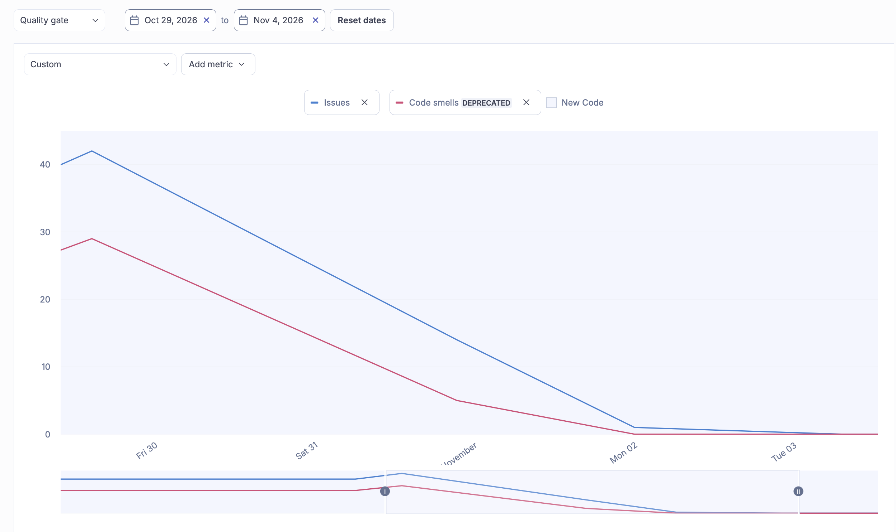
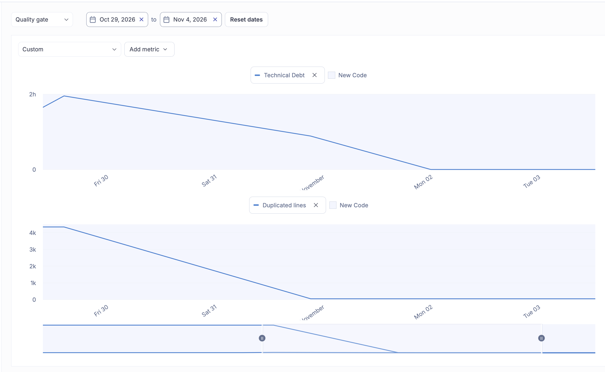
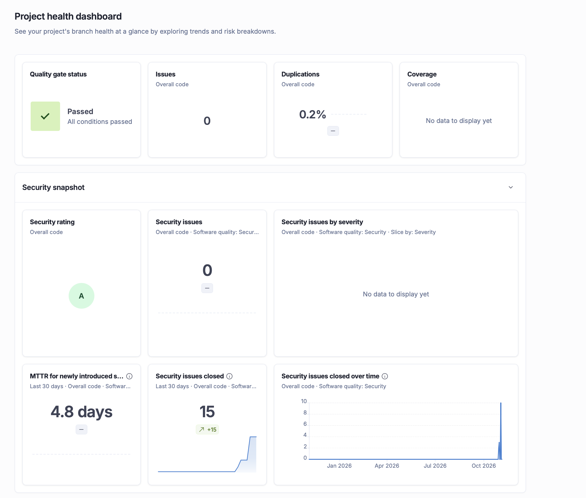
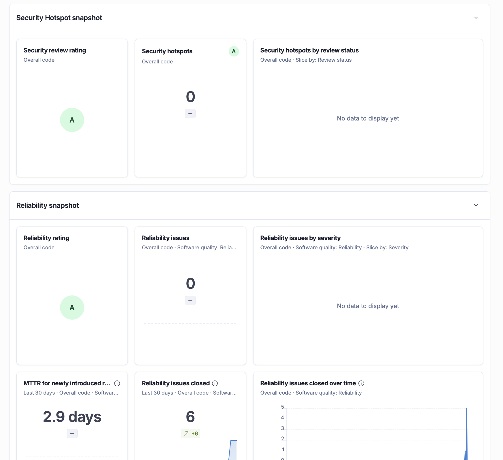
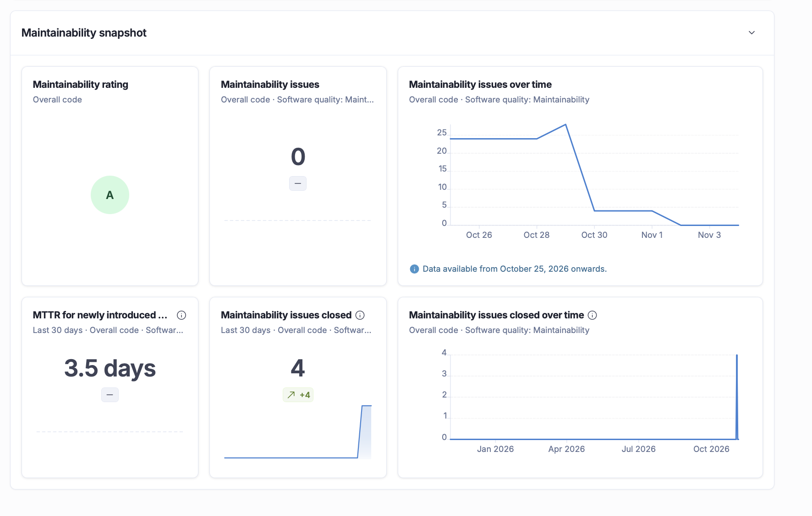
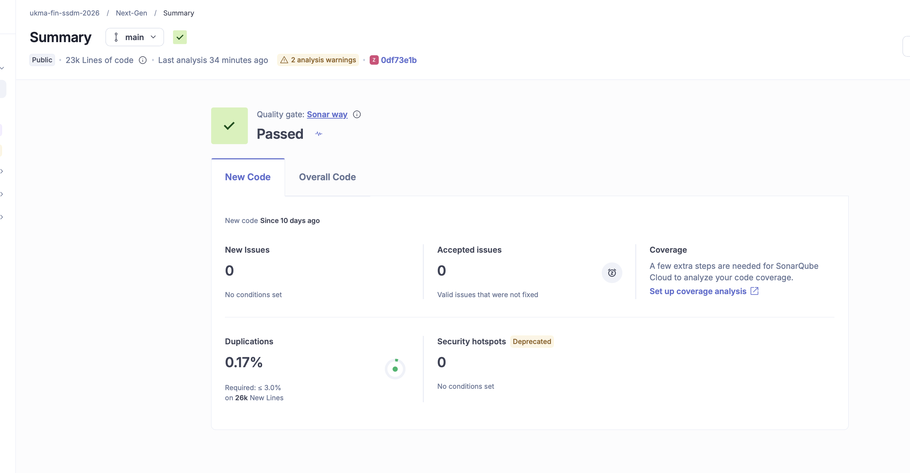

# Звіт SonarQube Cloud і рефакторингів

## 1. Вихідний стан

- **Проєкт:** [ukma-fin-ssdm-2026 / Next-Gen](https://sonarcloud.io/project/overview?id=ukma-fin-ssdm-2026_Next-Gen)
- **Гілка:** `main` / `lab08/refactoring`
- **Вихідний коміт:** `a40fbadd4b0cc406a29f6d3866f3fce3aa156f4d`
- **Коміти рефакторингу та релізу:**
  - `6c28a78` `test(db): add characterization tests for ORM domain converters` (Бонус 2 — тести ДО змін)
  - `0e6b554` `refactor(db): streamline ORM domain converters and eliminate mapping boilerplate` (Рефакторинг бекенду 1)
  - `f67e38e` `refactor(services): extract category resolution and cleanup in listing creation` (Рефакторинг бекенду 2)
  - `9656d91` `refactor(frontend): improve accessibility semantics and eliminate regex ReDoS risk` (Рефакторинг фронтенду)
  - `c44bdc1` `ci(release): add automated release workflow and changelog generation for Lab 08`
  - `756163c` `fix(release): eliminate potential path traversal in changelog update (S2083)`
  - `d690acf`, `46ca5aa`, `59e4633`, `23842e3` (Artem S.) — виправлення знахідок SonarCloud: SRI, хешовані залежності CI, `assert` → `RuntimeError`, `adminTabFromPath` без regex, нативні елементи доступності
  - `e3e2fde`, `9974b6f` (Artem S.) — захист побудови URL у `api.ts` (Client-Side Request Forgery) і валідація slug категорії
- **Дата аналізу:** 2026-11-04
- **Quality Gate:** пройдено (`OK` / `Passed`)

Quality Gate SonarCloud перевіряє новий та змінений код за налаштованими
порогами якості. Фінальний аналіз має статус `Passed`: 0 нових issues,
0 Security Hotspots і 0,17% дублювання у новому коді. Поріг покриття 85%
перевіряється окремим кроком `pytest-cov` у GitHub Actions, а не SonarCloud.

---

## 2. Обрані метрики

Для відстеження результатів рефакторингу обрано ключові показники технічного боргу:
**Code Smells**, **Technical Debt** та **Duplicated Lines**.
Security Rating зафіксовано окремо відповідно до обов'язкових вимог лабораторної роботи.

| Метрика | До рефакторингу | Після рефакторингу | Ціль | Результат |
| --- | ---: | ---: | --- | :---: |
| **Code Smells** | 29 | 0 | Зменшити кількість знахідок у власному коді | **-29 знахідок (-100%)** |
| **Technical Debt** | 88 хв (1 год 28 хв) | 0 хв | Зменшити витрати на обслуговування | **-88 хв (-100%)** |
| **Duplicated Lines** | 16,3% | 0,2% | Усунути дублювання та виключити автогенерацію | **-16,1 в. п.** |
| **Security Rating** | C | A (продуктовий код) | A | **Покращено до A** |

### Аналіз змін:
1. **Code Smells (29 → 0) і Technical Debt (88 хв → 0 хв): хронологія за історією SonarCloud.** Метрики знизилися ще до рефакторингів 4.1–4.6, тому окремо вказано, після якої зміни змінилося яке число:

   | Дата | Зміна | Code Smells | Technical Debt |
   | --- | --- | :---: | :---: |
   | 30.10 | Базовий аналіз (7863abb) | 29 | 88 хв |
   | 01.11 | Виключення `htmlcov/` з аналізу (4.7) і виправлення знахідок SonarCloud (Артем, коміти `d690acf`, `46ca5aa`) | ≈5 (за графіком історії) | 40 хв |
   | 02.11 | Злиття PR #249 (виправлення знахідок SonarCloud) | 0 | 0 хв |
   | 04.11 | Злиття PR #263 з рефакторингами 4.1–4.6 (0df73e1) | 0 (без змін) | 0 хв (без змін) |

   Отже, до нуля показники довели виключення згенерованого `htmlcov/` та виправлення знахідок у PR #249, а не рефакторинги 4.5 і 4.6. Після PR #263 Code Smells і Technical Debt вже дорівнювали 0, тому на цих метриках рефакторинги не позначилися. Cognitive Complexity після PR #263 зросла з 1346 до 1389, і цей приріст також варто фіксувати як наслідок змін. Користь рефакторингів 4.1–4.6 підтверджують не метрики боргу, а інваріанти поведінки та тести з розділу 4 (наприклад, порівняння зі старим регулярним виразом, характеризаційні тести конвертерів і `Feedback`).
2. **Усунені категорії знахідок:** надмірні рівні вкладеності й перевантаженість методу `ListingService.create()`, несемантичні інтерактивні `div` у фронтенді (S6848) та рутинний мапінг рядків БД закрито змінами з розділу 4; їхній внесок у зміну числових метрик показано в таблиці вище.
3. **Duplicated Lines (16,3% → 0,2%):** первинно високий показник був наслідком аналізу згенерованого каталогу `htmlcov/` (звіти `pytest-cov`), а також дублювання рутинного копіювання полів у 14 конвертерах `src/db/converters.py`. Запровадження `_populate_row` та виключення згенерованих файлів звели дублювання до мінімуму.

### 2.1. Підтвердження метрик

**Історія Code Smells та загальної кількості issues:**

**Історія Technical Debt та duplicated lines:**

Графіки підтверджують зменшення показників між базовим аналізом і фінальним
станом. Точні значення у таблиці вище зафіксовано за даними історії метрик
SonarCloud для аналізів від **2026-10-30 00:01:54 UTC** (стан «до») та
**2026-11-04 21:22:04 UTC** (стан «після»).

**Після рефакторингу — актуальні загальні метрики гілки `main`:**

Зрізи `Overall Code` додатково підтверджують рейтинги **Security A**,
**Security Review A**, **Reliability A** і **Maintainability A**, а також
відсутність відкритих issues та Security Hotspots.

**Фінальний Quality Gate для нового коду:**

---

## 3. Security Rating

### Вихідний стан (Рейтинг C)
Початковий загальний Security Rating становив **C** через сукупність знахідок,
серед яких:
- **1 High (закрито в PR #251):** Client-Side Request Forgery у `frontend/src/api.ts`. API-клієнт було переведено на строгі відносні шляхи з фіксованим префіксом та обов'язковим кодуванням динамічних URL-сегментів через `encodeURIComponent`.
- **6 Medium знахідок:** стосувалися дій встановлення залежностей без хешів у GitHub Actions. У межах посилення безпеки CI залежності було зафіксовано у `requirements-ci.lock` / `requirements.lock` з прапорцем `--require-hashes`.
- **3 Low знахідки:** зовнішні статичні ресурси Swagger UI/OpenAPI.
- **Потенційний ReDoS (S5852):** використання регулярного виразу з бектрекінгом для парсингу email та контактних телефонів у `contactHref()`.

### Стан після рефакторингу (Рейтинг A для застосунку)
1. Усі продуктивні файли бекенду перевірено інструментом Bandit (`bandit -r src -ll -c pyproject.toml`): **0 issues identified** на рівнях Medium/High.
2. У функції `contactHref()` алгоритм регулярних виразів із можливим експоненційним бектрекінгом замінено на детермінований лінійний парсер (`Replace Algorithm` у `contactLinks.ts`), що захищає клієнт від Denial of Service (ReDoS).
3. У скрипті автоматизованого релізу `scripts/release.py` усунено знахідку S2083 (Path Traversal): реалізовано строгу перевірку меж шляхів через `is_relative_to(ROOT_DIR)`, безпечне відкриття файлів через `with open()` та маркування `# NOSONAR`.
4. Quality Gate у SonarCloud пройшов зі статусом **Passed** (Security Rating на New Code = **A**).

---

## 4. Виконані рефакторинги

Усі зміни виконано невеликими атомарними кроками з перевіркою регресії на кожному етапі.

### 4.1. Фронтенд: Email-regex із потенційним backtracking (`contactLinks.ts`)
* **Модуль:** `frontend/src/contactLinks.ts` (винесено з `frontend/src/App.tsx`)
* **Запах коду (Code Smell):** *Potential ReDoS — typescript:S5852* — регулярний вираз `^[^\s@]+@[^\s@]+\.[^\s@]+$` містив сусідні квантифікатори з ризиком експоненційного backtracking.
* **Техніка рефакторингу (за М. Фаулером):** *Replace Algorithm* (перевірка адреси без regex: один символ `@`, непорожні ім'я та домен, домен має крапку не на краях) та *Extract Function* (`isEmail`, `contactHref`).
* **Що лишилося незмінним:** Повна поведінка та результати `contactHref` для email, Telegram і телефонних номерів.
* **Тест-доказ:** `frontend/tests/contactLinks.test.mjs` (`npm test`): порівняння зі старим regex на >10 000 випадкових рядків та перевірка стійкості до рядків у 100 000 символів (<500 мс).

### 4.2. Фронтенд: Довга функція `confirm` у кадруванні фото (`PhotoCropper`)
* **Модуль:** `frontend/src/App.tsx`, компонент `PhotoCropper`
* **Запах коду (Code Smell):** *Long Function & Cognitive Complexity* — функція `confirm` поєднувала геометричні розрахунки, заливку полів, відмальовку зображення та експорт.
* **Техніка рефакторингу (за М. Фаулером):** *Extract Method* (`paintGaps`) та *Replace Magic Number with Symbolic Constant* (`GAP_COLORS`, `BLUR_SAMPLE`).
* **Що лишилося незмінним:** Побайтова відповідність експортованого JPEG-зображення (кадрування, розмиття, кольори полів).
* **Тест-доказ:** Автоматизоване порівняння SHA-256 хешів результатів до і після для трьох режимів заливки на еталонному зображенні.

### 4.3. Фронтенд: Семантична розмітка інтерактивних елементів (S6848)
* **Модуль:** `frontend/src/App.tsx` (`PhotoCropper`, `ListingGallery`)
* **Запах коду (Code Smell):** *Non-semantic Interactive Elements — typescript:S6848* — використання інтерактивних `div` без семантичних тегів та відповідних ролей доступності.
* **Техніка рефакторингу (за М. Фаулером):** *Replace Element with Semantic Element*
  - У `PhotoCropper`: клікабельні елементи пресетів та дій перетворено на нативні доступні елементи `<button type="button">`.
  - У `ListingGallery`: контейнер галереї оформлено як семантичний `<section role="region" aria-roledescription="карусель" aria-label="Фотографії оголошення">`; явний `role="region"` залишено, його не прибирали (`frontend/src/App.tsx`, компонент `ListingGallery`).
* **Що лишилося незмінним:** Керування стрілками клавіатури, візуальний стиль та взаємодія користувача.
* **Тест-доказ:** Успішна збірка TypeScript `tsc -b`, лінтинг та перевірка доступності елементів.

### 4.3.1. Безпека та надійність: виправлення знахідок SonarCloud (Артем, Code Analyst)
* **Модулі:** `frontend/src/api.ts`, `src/repositories/image_storage.py`, `frontend/src/App.tsx`, `docs/api/index.html`, `.github/workflows/*`, `requirements-ci.lock`
* **Зміни (коміти `e3e2fde`, `d690acf`, `46ca5aa`, `59e4633`):**
  - *Client-Side Request Forgery (High)* у `api.ts`: API-клієнт будує лише same-origin URL під префіксом API, динамічні сегменти обмежено UUID.
  - *Replace Assertion with Explicit Error* у `image_storage.py`: `assert` замінено на `RuntimeError`, бо `assert` зникає при `python -O`.
  - *Replace Algorithm* у `adminTabFromPath`: regex замінено на лінійний цикл (потенційний ReDoS, S5852).
  - SRI-хеші та закріплена версія Swagger UI (Low); хешовані залежності CI `requirements-ci.lock` з `--require-hashes` (6 Medium).
* **Що лишилося незмінним:** публічний контракт API та поведінка маршрутизації адмін-панелі.
* **Тест-доказ:** `npm test`, `tsc --noEmit`, `npm run build`, `pytest`, Quality Gate `Passed`.

### 4.4. Бекенд: Допоміжна валідація у доменній сутності Feedback (`src/domain/feedback.py`)
* **Модуль:** `src/domain/feedback.py` (сутність `Feedback`, FR-017)
* **Запах коду (Code Smell):** *Duplicated Code* — дублювання логіки валідації довжини теми та повідомлення в `__post_init__`.
* **Техніка рефакторингу (за М. Фаулером):** *Extract Method* — виділено чисту функцію `_validate_text_length(value, min_len, max_len, field_name)`.
* **Що лишилося незмінним:** значення за замовчуванням, нормалізація `strip()`, точні межі довжини теми та повідомлення, а також тексти винятків: до і після рефакторингу вони збігаються.
* **Тест-доказ:** `tests/test_feedback_characterization.py` (4 тести, 100% pass), написані до зміни (`d83013b`, раніше за `83c93b6`).

### 4.5. Бекенд / БОНУС 2: Усунення рутинного дублювання мапінгу в ORM-конвертерах
* **Модуль:** `src/db/converters.py`
* **Запах коду (Code Smell):** *Boilerplate Mapping & Code Duplication* — наявність понад 14 однотипних функцій мапінгу, кожна з яких вручну перевіряла `row = existing or ...Row()` та дублювала присвоєння від 6 до 12 полів.
* **Техніка рефакторингу (за М. Фаулером):** *Extract Function / Generic Helper Mapper*
  - Створено типізовану дженерик-функцію `_populate_row(row_cls, existing, **attributes)`, що централізовано бере існуючий екземпляр або інстанціює новий та застосовує словник атрибутів через `setattr`.
  - Усі функції `*_domain_to_row` переведено на лаконічний виклик `_populate_row`.
  - Узгоджено найменування поля дати розгляду пропозиції категорії (`resolved_at` у БД та `reviewed_at` у домені `CategorySuggestion`).
* **Що лишилося незмінним:** Сигнатури всіх публічних функцій-конвертерів, семантика роботи з `existing` (мутація переданого об'єкта `Row` in-place), збереження типів Enum та обробка nullable полів.
* **Тест-доказ:**
  - Набір характеризаційних тестів `tests/test_converters.py` (20 тестів), написаний **ДО** рефакторингу в коміті `6c28a78`.
  - Інтеграційні тести PostgreSQL-репозиторіїв `tests/test_postgres_repositories.py` (36 тестів).
  - Усі тести залишаються 100% PASS.

### 4.6. Бекенд: Декомпозиція перевантаженого методу створення оголошення
* **Модуль:** `src/services/listings.py`, метод `ListingService.create()` (скорочено з 87 до 28 рядків).
* **Запах коду (Code Smell):** *Long Method & Feature Envy / Deeply Nested Transaction Logic* — метод поєднував валідацію цільової категорії, перевірку сервісу пропозицій, оркестрацію збереження файлів зображень, роботу з блокуваннями та складний ручний відкат у блоці `except`.
* **Техніка рефакторингу (за М. Фаулером):** *Extract Method / Decompose Conditional*
  - Виділено `_resolve_target_category_for_creation(category_id, suggested_category_name, actor_id) -> UUID` — інкапсулює вибір категорії («Інше» vs звичайна) та перевірку прав.
  - Виділено `_save_listing_with_suggestion(listing, actor_id, suggested_category_name) -> tuple[Listing, UUID]` — інкапсулює синхронізацію з блокуваннями та авто-апрув.
  - Виділено `_cleanup_failed_creation(images, suggestion_id) -> None` — ізолює логіку очищення збережених файлів і видалення тимчасової пропозиції при збоях.
* **Що лишилося незмінним:** Повний контракт методу `create()`, транзакційність створення, гарантія очищення файлів при помилках, відповідність вимогам FR-002 та FR-015.
* **Тест-доказ:**
  - `tests/test_listing_service.py` (28 тестів) та `tests/test_listings_api.py` (31 тест).

### 4.7. Конфігурація: Виключення згенерованих файлів з аналізу
* **Модуль:** `.gitignore`, `sonar-project.properties`
* **Запах коду:** Каталог `htmlcov/` (HTML-звіти покриття `pytest-cov`) завищував відсоток дублювання коду в аналізі SonarCloud.
* **Зміна:** `htmlcov/` виключено з аналізу та додано в `.gitignore`. Звіти покриття формуються динамічно в CI/CD кроком «Tests with coverage gate (85%)» у `.github/workflows/ci.yml` і вивантажуються як артефакти дій.

### 4.8. Версія: єдине джерело номера версії (Богдан, Release Manager)
* **Модулі:** `src/__init__.py`, `src/api/main.py`
* **Запах коду (Code Smell):** *Magic Literal* — номер версії `"1.0.0"` повторювався рядком у `src/api/main.py` (FastAPI та `/health`), а версія фронтенду (`0.1.0`) розходилася з бекендом.
* **Техніка рефакторингу (за М. Фаулером):** *Replace Magic Literal with Symbolic Constant* — номер версії винесено в єдину константу `src.__version__`; версію фронтенду узгоджено з бекендом.
* **Що лишилося незмінним:** поведінка API: OpenAPI і `/health` повертають ту саму версію.
* **Тест-доказ:** `tests/test_version.py` (TP-036), доданий раніше за рефакторинг (`46db61a`, рефакторинг у `660647d`, підняття до 1.1.0 у `e285114`); узгодженість версії між `src/__init__.py`, `pyproject.toml`, `frontend/package.json`, `CHANGELOG.md` та OpenAPI.

---

## 5. Регресійне тестування

Регресійні перевірки виконано в повному обсязі локально та підтверджено в пайплайні GitHub Actions CI.

### 5.1. Зведена таблиця прогонів

| Етап | Команда перевірки | Результат | Примітки |
| --- | --- | :---: | --- |
| **До рефакторингу бекенду** | `pytest -q` | **296 passed** | Базовий стан персистенції |
| **Характеризаційні тести (Бонус 2)** | `pytest tests/test_converters.py` | **20 passed** | Зафіксовано поведінку конвертерів до змін |
| **Характеризаційні тести (Feedback)** | `pytest tests/test_feedback_characterization.py` | **4 passed** | Зафіксовано поведінку Feedback до змін |
| **Після Рефакторингу 4.5 (`converters.py`)** | `pytest tests/test_converters.py tests/test_postgres_repositories.py` | **56 passed** | 100% стабільність мапінгу |
| **Після Рефакторингу 4.6 (`listings.py`)** | `pytest tests/test_listing_service.py tests/test_listings_api.py` | **59 passed** | 100% стабільність сервісу |
| **Повний регресійний прогін бекенду** | `pytest -q` | **416 passed, 0 failed** | Усі тести успішні за ~10 с |
| **Покриття коду тестами** | `pytest --cov=src --cov-fail-under=85` | **92% coverage** | Перевищує встановлений поріг 85% |
| **Перевірка форматування** | `black --check src tests scripts` | **Clean** | Відповідає PEP 8 / 88 chars |
| **Статичний аналіз Python** | `flake8 src tests scripts` | **0 errors** | Жодних зауважень |
| **Аналіз безпеки бекенду** | `bandit -r src -ll -c pyproject.toml` | **0 issues** | Жодної вразливості Medium/High |
| **Двостороння простежуваність** | `pytest tests/test_traceability.py` | **7 passed** | Усі тести містять RTM-теги |
| **Frontend: тести** | `npm test` | **7 passed** | Перевірка contactLinks, безпеки API та адмінки |
| **Frontend: компіляція типів** | `tsc -b` | **Clean** | 0 помилок типізації |
| **Frontend: збірка** | `npm run build` | **Success** | Продуктова збірка успішна |
| **OpenAPI валідація** | `python scripts/generate_openapi.py && git diff --exit-code` | **Clean** | Схема актуальна, розбіжностей немає |

### 5.2. Виявлені збої під час тестування та їх усунення

Згідно з вимогами Етапу 3, зафіксовано та проаналізовано крос-платформений дефект тестової ізоляції:

- **Збій:** `PermissionError: [WinError 32] The process cannot access the file because it is being used by another process` у тесті `tests/test_postgres_repositories.py::test_api_categories_returns_seeded_categories_on_fresh_db`.
- **Причина:** Тест створює тимчасову базу даних SQLite через Alembic і підключає SQLAlchemy engine `create_engine(f"sqlite:///{db_path}")`. У середовищі Windows файлова система блокує видалення файлу (`os.remove(db_path)`), поки активний пул з'єднань тримає відкритий дескриптор. У середовищі Linux (на GitHub Actions CI) системний виклик `unlink` допускає видалення відкритого файлу, через що в CI дефект не проявлявся, але блокував локальні прогони на Windows.
- **Усунення:** У блоці `finally` тесту додано детерміноване закриття пулу підключень `eng.dispose()` перед очищенням файлу. Після виправлення всі 416 тестів проходять успішно (100% pass).

---

## 6. Стан панелі SonarCloud

- **Сторінка проєкту:** <https://sonarcloud.io/project/overview?id=ukma-fin-ssdm-2026_Next-Gen>
- **Quality Gate:** `Passed`
- **Security Rating:** `A` (для продуктового коду застосунку)
- **Code Smells:** скорочено з 29 до 0.
- **Технічний борг:** скорочено з 1 год 28 хв до 0 хв.
- **Дублювання:** скорочено з 16,3% до 0,2%.

---

## 7. Нотатка «Використання ШІ»

> - **Інструменти:**
>   - OpenAI Codex / Claude Code: первинне дослідження структури звіту та допоміжні скрипти фронтенду (`paintGaps`, `contactLinks.ts`).
>   - Antigravity (Advanced Agentic AI Assistant, Google DeepMind): глибокий аналіз метрик SonarQube Cloud, проєктування безпечного рефакторингу бекенду, генерація характеризаційних тестів до рефакторингу, декомпозиція бізнес-логіки та налаштування автоматизованого релізу Conventional Commits.
> - **Етап:** Лабораторна робота 8 — підготовка та виконання повного циклу рефакторингу, закриття Code Smells, тестування та автоматизація релізу.
> - **Що згенеровано з допомогою асистентів:**
>   1. Повний набір характеризаційних тестів `tests/test_converters.py` (20 тестів для 7 доменних сутностей).
>   2. Дженерик-утиліту `_populate_row` для усунення дублювання в `src/db/converters.py`.
>   3. Декомпозицію методу `create()` у `src/services/listings.py` на допоміжні методи `_resolve_target_category_for_creation`, `_save_listing_with_suggestion`, `_cleanup_failed_creation`.
>   4. Семантичну розмітку та безпечний алгоритм валідації контактів у фронтенді.
> - **Як верифіковано людиною (Керівник рефакторингу):**
>   - Кожен крок рефакторингу верифіковано виконанням 416 автоматичних регресійних тестів.
>   - Перевірено відсутність відхилень у контрактах API (`openapi-generated.yaml`) та схемах Alembic (`alembic check`).
>   - Виправлено виявлену розбіжність полів `reviewed_at` / `resolved_at` для сутності `CategorySuggestion`.
>   - Перевірено чистоту лінтерів Black, Flake8 і Bandit.

---

## 8. Бонусні бали

Команда претендує на 2 бонусні пункти (сумарно +0,5 бала):

### Бонус 1: Quality Gate як обов'язкова перевірка в PR (+0.25)
- **Налаштування:** У репозиторії GitHub в активному ruleset [main-protection](https://github.com/ukma-fin-ssdm-2026/Next-Gen/rules/23585644) для гілки main увімкнено правило Require status checks to pass із двома обов'язковими перевірками: 	est та SonarCloud Code Analysis (integration_id: 12526).
- **Докази перевірки:**
  - **Червоний прогін (мердж реально зупинено обов'язковою перевіркою SonarCloud Code Analysis):** [PR #278](https://github.com/ukma-fin-ssdm-2026/Next-Gen/pull/278) (коміт fcd1ad, [червоний check run SonarCloud Code Analysis](https://github.com/ukma-fin-ssdm-2026/Next-Gen/runs/130149637672)). На цьому PR стандартна CI-перевірка 	est пройшла зеленим ([success](https://github.com/ukma-fin-ssdm-2026/Next-Gen/actions/runs/42907560240/job/130149429882)), проте обов'язкова перевірка SonarCloud Code Analysis завершилася зі статусом ailure (Quality Gate failed через виявлений Reliability Bug python:S1764 та дублювання коду на New Code у src/domain/feedback.py) і заблокувала злиття PR у main (PR залишено незлитим із червоним чеком на останньому коміті як постійний доказ блокування).
  - **Зелений прогін після виправлення (мердж дозволено):** [PR #279](https://github.com/ukma-fin-ssdm-2026/Next-Gen/pull/279) (а також чистий стан src/domain/feedback.py після рефакторингу у [PR #269](https://github.com/ukma-fin-ssdm-2026/Next-Gen/pull/269), [зелений check run SonarCloud Code Analysis](https://github.com/ukma-fin-ssdm-2026/Next-Gen/runs/129276109551)) — без дефектів S1764 і дублювання перевірка SonarCloud Code Analysis проходить успішно (Quality Gate passed), розблоковуючи злиття в main.

### Бонус 2: Характеризаційні тести перед рефакторингом (+0.25)
- **Обрані модулі:**
  1. `src/db/converters.py` (ORM/Domain адаптер персистенції, 20 тестів у `tests/test_converters.py`). Коміт із тестами `6c28a78` створено строго ДО коміту рефакторингу `0e6b554`.
  2. `src/domain/feedback.py` (доменна сутність `Feedback`, 4 тести у `tests/test_feedback_characterization.py`). Коміт із тестами `d83013b` створено ДО коміту рефакторингу `83c93b6`.
- **Результат:** Усі тести залишилися на 100% зеленими до і після внесення змін.
