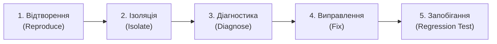

# Журнал налагодження (Debugging Log)

> **Лабораторна робота 6:** Тестування та налагодження  
> **Роль:** Керівник налагодження – Ізоляція помилок та виправлення (Debugging Lead)  
> **Виконавець:** Данііл Чернявський ([@megatr4n](https://github.com/megatr4n))  
> **Проєкт:** Платформа студентських оголошень НаУКМА (*Baraholka NaUKMA*)  
> **Дата:** 21 жовтня 2026 р.

---

## 1. Огляд челенджу налагодження («Зламай, потім відлагодь»)

У межах інтерактивного командного челенджу «Зламай, потім відлагодь» (Break-then-Debug) вихідна кодова база перебувала у стабільному стані: базовий тестовий набір із 33 тестів на гілці `main` проходив стовідсотково успішно.

Для відпрацювання повного інженерного циклу налагодження у сервісний шар фільтрації каталогу оголошень за ціною у [`src/services/listings.py`](../../src/services/listings.py) було навмисно введено критичний дефект: **інвертовано умову валідації цінового діапазону (`min_price <= max_price` замість `min_price > max_price`)**.

### Наслідки введення дефекту:
1. **Злам коректних запитів:** Будь-які валідні запити клієнтів із правильно заданими межами (наприклад, `min_price=100.0, max_price=200.0`) несподівано відхилялися винятком `InvalidPriceRangeError`, що спричинило падіння наявного тесту `test_filter_by_price_range`.
2. **Пропуск некоректних даних:** Запити з інвертованим інтервалом (наприклад, `min_price=200.0, max_price=100.0`), де нижня межа перевищує верхню, проходили повз перевірку без генерації помилки та призводили до маскування дефекту користувацького введення (тихе повернення порожнього списку `[]`).

---

## 2. Систематичний процес налагодження (5 етапів)



### Етап 1: Відтворення помилки (Reproduce)
- **Дія 1 (Виявлення падіння наявного набору):**
  Після ін'єкції дефекту було виконано прогін тестового набору:
  ```bash
  pytest tests/test_listing_service.py -k "test_filter_by_price_range" -v
  ```
- **Фактичний результат тесту:**
  ```text
  FAILED tests/test_listing_service.py::test_filter_by_price_range - src.domain.exceptions.InvalidPriceRangeError: min_price (100.0) не може перевищувати max_price (200.0)
  ```
- **Дія 2 (Фіксація поведінки інвертованого запиту):**
  Виконано запит до API з інвертованим інтервалом:
  ```http
  GET /api/v1/listings?min_price=200&max_price=100 HTTP/1.1
  Host: localhost:8000
  ```
  API повернуло статус `HTTP 200 OK` зі значенням `[]` замість очікуваної помилки клієнтської валідації `HTTP 422 Unprocessable Content`.
- **Створення тестів для точного відтворення дефекту:**
  Створено два цільових тести-свідки:
  1. [`test_list_public_rejects_inverted_price_range`](../../tests/test_listing_service.py) – фіксує обов'язковість генерації винятку при `min_price > max_price`.
  2. [`test_catalog_rejects_inverted_price_range`](../../tests/test_listings_api.py) – фіксує повернення статусу `HTTP 422` та структури помилки.

### Етап 2: Ізоляція несправності (Isolate)
- **Аналіз шару контролерів ([`src/api/routers/listings.py`](../../src/api/routers/listings.py)):**
  Перевірено декларативні обмеження FastAPI:
  `min_price: Optional[float] = Query(None, ge=0)`
  `max_price: Optional[float] = Query(None, ge=0)`
  Обидва параметри незалежно валідуються Pydantic як невід'ємні числа, проте FastAPI не здійснює реляційної перевірки зв'язку між різними query-параметрами.
- **Аналіз сервісного шару ([`src/services/listings.py`](../../src/services/listings.py)):**
  У методі `list_public` було виявлено помилкову перевірку:
  ```python
  if min_price is not None and max_price is not None and min_price <= max_price:
      raise InvalidPriceRangeError(...)
  ```
  Збій локалізовано безпосередньо в логічному виразі перевірки цінових меж у сервісі.

### Етап 3: Діагностика першопричини (Diagnose)
1. **Коренева причина 1 (Логічна інверсія умови):**
   Використання оператора `<=` замість `>` призвело до прямо протилежного ефекту: система блокувала коректні діапазони й пропускала некоректні.
2. **Коренева причина 2 (Невідповідність контракту валідаційних помилок API):**
   Початкова трансляція `InvalidPriceRangeError` повертала простий текстовий рядок `detail=str(exc)`. Проте специфікація проєкту ([`docs/api/api-design.md`](../../docs/api/api-design.md), рядки 87–98) вимагає, щоб будь-які помилки валідації `422 Unprocessable Content` повертали стандартизований масив об'єктів FastAPI/Pydantic із ключами `loc`, `msg` та `type`. Клієнти, розраховані на парсинг списку помилок, зазнавали збою під час обробки рядка.

### Етап 4: Виправлення (Fix)
Згідно з принципами Clean Architecture та контрактом API:
1. **Доменний шар ([`src/domain/exceptions.py`](../../src/domain/exceptions.py)):**
   Оголошено чистий доменний виняток:
   ```python
   class InvalidPriceRangeError(ListingError):
       """Мінімальна ціна фільтрації перевищує максимальну ціну."""
   ```
2. **Сервісний шар ([`src/services/listings.py`](../../src/services/listings.py)):**
   Виправлено оператор на `>` та інкапсульовано перевірку у приватний метод:
   ```python
   @staticmethod
   def _validate_price_range(min_price: float | None, max_price: float | None) -> None:
       if min_price is not None and max_price is not None and min_price > max_price:
           raise InvalidPriceRangeError(
               f"min_price ({min_price}) не може перевищувати max_price ({max_price})"
           )
   ```
3. **Рівень API ([`src/api/routers/listings.py`](../../src/api/routers/listings.py)):**
   Нормалізовано відповідь у функції `_raise_domain` відповідно до формату Pydantic `HTTPValidationError`:
   ```python
   if isinstance(exc, InvalidPriceRangeError):
       raise HTTPException(
           status_code=status.HTTP_422_UNPROCESSABLE_CONTENT,
           detail=[
               {
                   "loc": ["query", "min_price"],
                   "msg": str(exc),
                   "type": "value_error",
               }
           ],
       )
   ```

### Етап 5: Запобігання повторенню (Prevent Recurrence / Regression Testing)
Розроблено та верифіковано автоматизовані тести:
1. **Модульний тест доменного сервісу** у [`tests/test_listing_service.py`](../../tests/test_listing_service.py):
   - [`test_filter_by_price_range`](../../tests/test_listing_service.py) – підтверджує успішну фільтрацію коректного діапазону `100.0 <= price <= 200.0`.
   - [`test_list_public_rejects_inverted_price_range`](../../tests/test_listing_service.py) – гарантує детерміністичний викид `InvalidPriceRangeError` при спробі передати `min_price > max_price`.
2. **Інтеграційний API-тест** у [`tests/test_listings_api.py`](../../tests/test_listings_api.py):
   - [`test_catalog_rejects_inverted_price_range`](../../tests/test_listings_api.py) – гарантує повернення статусу `HTTP 422` та валідацію стандартної структури `detail` зі списком помилок.

---

## 3. Детальний аналіз дефекту

### Симптом (Symptom)
- При введенні коректного інтервалу користувач отримував помилку сервера.
- При введенні інвертованого інтервалу (від 200 до 100 грн) сервер повертав `200 OK` зі значенням `[]`, вказуючи «оголошень не знайдено» замість попередження про некоректні вхідні межі.

### Причина (Cause)
Логічна помилка інверсії умови порівняння в бізнес-правилі фільтрації, поєднана з нестандартним форматом тіла відповіді помилки 422 у роутері.

### Порівняння коду

#### До виправлення (з дефектом):
```python
# src/services/listings.py
def list_public(self, ..., min_price: float | None = None, max_price: float | None = None, ...):
    # Дефект: умова інвертована, блокуються коректні інтервали
    if min_price is not None and max_price is not None and min_price <= max_price:
        raise InvalidPriceRangeError(...)
    ...
```

#### Після виправлення:
```python
# src/services/listings.py
def list_public(self, ..., min_price: float | None = None, max_price: float | None = None, ...):
    self._validate_price_range(min_price, max_price)
    items = [item for item in self._repository.list_all() if item.is_public()]
    if min_price is not None:
        items = [item for item in items if item.price >= min_price]
    if max_price is not None:
        items = [item for item in items if item.price <= max_price]
    ...

@staticmethod
def _validate_price_range(min_price: float | None, max_price: float | None) -> None:
    if min_price is not None and max_price is not None and min_price > max_price:
        raise InvalidPriceRangeError(
            f"min_price ({min_price}) не може перевищувати max_price ({max_price})"
        )
```

Регресійні тести:
- [`tests/test_listing_service.py::test_filter_by_price_range`](../../tests/test_listing_service.py)
- [`tests/test_listing_service.py::test_list_public_rejects_inverted_price_range`](../../tests/test_listing_service.py)
- [`tests/test_listings_api.py::test_catalog_rejects_inverted_price_range`](../../tests/test_listings_api.py)

### Уроки на майбутнє (Lessons Learned)
1. **Реляційна валідація діапазонів:** Парні параметри (`min/max`, `start/end`, `from/to`) обов'язково повинні перевірятися на коректність інтервалу на рівні бізнес-правил домену.
2. **Єдиний формат помилок API:** Специфікація відповідей на помилки валідації 422 повинна бути уніфікованою: клієнти очікують масив помилок Pydantic (`detail: [...]`), а не звичайний текстовий рядок.
3. **Дисципліна систематичного налагодження:** Повний цикл «відтворення → ізоляція → діагностика → виправлення → регресійний захист» гарантує збереження стабільності кодової бази та унеможливлює повторне виникнення багу.

---

## 4. Бонусне завдання: Property-Based тестування інваріантів фільтрації (Hypothesis)

Для забезпечення абсолютної стійкості виправленого цінового фільтра розроблено набір тестування на основі властивостей (Property-Based Testing) за допомогою бібліотеки `hypothesis` у [`tests/test_properties.py`](../../tests/test_properties.py).

- **Формулювання властивості (Property Invariant):**  
  > *Для будь-яких псевдовипадково згенерованих цін `min_price` та `max_price`: якщо `min_price <= max_price`, каталог повертає виключно ті активні оголошення, ціна яких потрапляє в інтервал `[min_price, max_price]`; якщо ж `min_price > max_price`, система детерміністично відхиляє запит винятком `InvalidPriceRangeError` незалежно від конкретних числових значень.*

- **Результати тестування:**  
  Інструмент Hypothesis автоматично генерує 50 різноманітних комбінацій значень (екстремальні нульові ціни, дробові границі, граничні рівні `min_price == max_price`, інвертовані пари), підтверджуючи непорушність інваріанта.

---

> ### Нотатка «Використання ШІ»
> - **Інструменти:** Google Antigravity / Gemini 2.5 Pro.
> - **Етап:** Проєктування челенджу «Зламай, потім відлагодь», систематизація 5 кроків налагодження, аналіз контракту API 422 та розробка тестів Hypothesis.
> - **Що згенеровано:** Структура журналу налагодження `debugging-log.md`, шаблони доменного винятку `InvalidPriceRangeError`, нормалізація формату `detail` для FastAPI, тест властивостей `test_property_price_filter_invariant`.
> - **Що перевірено / відкинуто вручну:**
>   - Реалізовано нормалізацію структури відповіді HTTP 422 до стандарту OpenAPI `detail: list[dict]` замість одинарного рядка.
>   - Усі посилання в документі замінено на відносні шляхи репозиторію для повної портативності.
>   - Повний набір тестів (37 тестів, 100% pass) перевірено локально через pytest, статичний аналіз верифіковано через Flake8, Black та Bandit.
