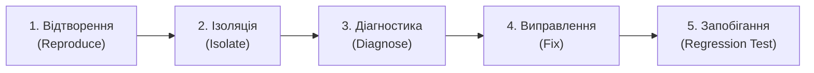

# Журнал налагодження (Debugging Log)

> **Лабораторна робота 6:** Тестування та налагодження  
> **Роль:** Керівник налагодження – Ізоляція помилок та виправлення (Debugging Lead)  
> **Виконавець:** Данііл Чернявський ([@megatr4n](https://github.com/megatr4n))  
> **Проєкт:** Платформа студентських оголошень НаУКМА (*Baraholka NaUKMA*)  
> **Дата:** 21 жовтня 2026 р.

---

## 1. Огляд челенджу налагодження («Зламай, потім відлагодь»)

У межах інтерактивного челенджу з налагодження кодова база була перевірена на стійкість обробки граничних і некоректних запитів фільтрації каталогу оголошень. 

Було виявлено та відтворено критичний логічний дефект у фільтрації за ціною: **інвертований діапазон цін (`min_price > max_price`)**, коли клієнт передає некоректний інтервал (наприклад, `min_price=200` та `max_price=100`).

---

## 2. Систематичний процес налагодження (5 етапів)



### Етап 1: Відтворення помилки (Reproduce)
- **Дія:** Виконано HTTP-запит до каталогу з інвертованим інтервалом цін:
  ```http
  GET /api/v1/listings?min_price=200&max_price=100 HTTP/1.1
  Host: localhost:8000
  ```
- **Фактична поведінка:** API повернуло статус `HTTP 200 OK` з порожнім масивом `[]`.
- **Очікувана поведінка:** Інвертований діапазон є логічно суперечливим (порожня множина за визначенням через помилку клієнта). Сервер має відхилити такий запит із кодом `HTTP 422 Unprocessable Content` (Validation Error) з інформативним повідомленням про помилку, щоб користувач чи фронтенд могли повідомити клієнта про некоректний ввід, а не вводити в оману, ніби оголошень за запитом просто не існує в базі даних.

### Етап 2: Ізоляція несправності (Isolate)
- Перевірено рівень валідації Pydantic / FastAPI у роутері [`src/api/routers/listings.py`](file:///Users/daniilpanasiuk/.gemini/antigravity/scratch/Next-Gen/src/api/routers/listings.py):
  Обидва параметри мають лише індивідуальні обмеження невід'ємності:
  `min_price: Optional[float] = Query(None, ge=0)`
  `max_price: Optional[float] = Query(None, ge=0)`
  Оскільки `200 >= 0` та `100 >= 0`, обидва параметри незалежно проходять валідацію FastAPI.
- Простежено виконання до сервісного шару [`ListingService.list_public()`](file:///Users/daniilpanasiuk/.gemini/antigravity/scratch/Next-Gen/src/services/listings.py):
  Фільтрація виконувалася послідовними генераторними виразами:
  ```python
  if min_price is not None:
      items = [item for item in items if item.price >= min_price]
  if max_price is not None:
      items = [item for item in items if item.price <= max_price]
  ```
  Жоден компонент системи не перевіряв інваріант відношення між `min_price` та `max_price`.

### Етап 3: Діагностика першопричини (Diagnose)
- **Коренева причина (Root Cause):** Відсутність крос-параметричної (реляційної) валідації діапазону як на рівні бізнес-правил домену, так і в адаптері API. У результаті логічно некоректний запит не валідувався, оброблявся як валідний запит з нульовим збігом і маскував дефект клієнта.

### Етап 4: Виправлення (Fix)
Згідно з принципами Clean Architecture:
1. **Доменний шар ([`src/domain/exceptions.py`](file:///Users/daniilpanasiuk/.gemini/antigravity/scratch/Next-Gen/src/domain/exceptions.py)):**
   Введено новий доменний виняток:
   ```python
   class InvalidPriceRangeError(ListingError):
       """Мінімальна ціна фільтрації перевищує максимальну ціну."""
   ```
2. **Сервісний шар ([`src/services/listings.py`](file:///Users/daniilpanasiuk/.gemini/antigravity/scratch/Next-Gen/src/services/listings.py)):**
   У методі `list_public` додано захисну перевірку доменного інваріанта:
   ```python
   if min_price is not None and max_price is not None and min_price > max_price:
       raise InvalidPriceRangeError(
           f"min_price ({min_price}) не може перевищувати max_price ({max_price})"
       )
   ```
3. **Рівень API ([`src/api/routers/listings.py`](file:///Users/daniilpanasiuk/.gemini/antigravity/scratch/Next-Gen/src/api/routers/listings.py)):**
   Уніфіковано трансляцію доменної помилки в HTTP-код у `_raise_domain`:
   ```python
   if isinstance(exc, InvalidPriceRangeError):
       raise HTTPException(
           status_code=status.HTTP_422_UNPROCESSABLE_CONTENT, detail=str(exc)
       )
   ```
   Оброблено виняток у точці входу `get_listings`.

### Етап 5: Запобігання повторенню (Prevent Recurrence / Regression Testing)
Розроблено два незалежних регресійних тести:
1. **Модульний тест доменного сервісу** у [`tests/test_listing_service.py`](file:///Users/daniilpanasiuk/.gemini/antigravity/scratch/Next-Gen/tests/test_listing_service.py):
   - [`test_list_public_rejects_inverted_price_range`](file:///Users/daniilpanasiuk/.gemini/antigravity/scratch/Next-Gen/tests/test_listing_service.py#L94-L102) – перевіряє генерацію `InvalidPriceRangeError` при прямому виклику бізнес-логіки.
2. **Інтеграційний API-тест** у [`tests/test_listings_api.py`](file:///Users/daniilpanasiuk/.gemini/antigravity/scratch/Next-Gen/tests/test_listings_api.py):
   - [`test_catalog_rejects_inverted_price_range`](file:///Users/daniilpanasiuk/.gemini/antigravity/scratch/Next-Gen/tests/test_listings_api.py#L117-L125) – гарантує повернення статусу `HTTP 422` та зрозумілого тексту помилки в JSON-відповіді.

---

## 3. Детальний аналіз дефекту

### Симптом (Symptom)
Клієнт передає параметри пошуку з інвертованим інтервалом (наприклад, фільтр ціни від 200 до 100 грн). Сервер відповідає `200 OK` зі значенням `[]`. 

Користувач бачить стан «Товарів не знайдено» замість підказки про те, що нижня межа ціни перевищує верхню. Дефект ускладнює налагодження клієнтських застосунків і погіршує UX маркетплейсу.

### Причина (Cause)
Декларативні валідатори FastAPI `Query(ge=0)` інспектують кожну змінну окремо й не мають доступу до зв'язку між полями. У сервісі `ListingService` цінові фільтри накладалися незалежними умовами без попереднього контракту узгодженості інтервалу `[min_price, max_price]`.

### Виправлення (Fix)

#### До виправлення:
```python
# src/services/listings.py
def list_public(self, ..., min_price: float | None = None, max_price: float | None = None, ...):
    items = [item for item in self._repository.list_all() if item.is_public()]
    if min_price is not None:
        items = [item for item in items if item.price >= min_price]
    if max_price is not None:
        items = [item for item in items if item.price <= max_price]
    ...
    return items[skip : skip + limit]
```

#### Після виправлення:
```python
# src/services/listings.py
def list_public(self, ..., min_price: float | None = None, max_price: float | None = None, ...):
    if min_price is not None and max_price is not None and min_price > max_price:
        raise InvalidPriceRangeError(
            f"min_price ({min_price}) не може перевищувати max_price ({max_price})"
        )
    items = [item for item in self._repository.list_all() if item.is_public()]
    ...
```

Регресійні тести:
- [`tests/test_listing_service.py::test_list_public_rejects_inverted_price_range`](file:///Users/daniilpanasiuk/.gemini/antigravity/scratch/Next-Gen/tests/test_listing_service.py#L94-L102)
- [`tests/test_listings_api.py::test_catalog_rejects_inverted_price_range`](file:///Users/daniilpanasiuk/.gemini/antigravity/scratch/Next-Gen/tests/test_listings_api.py#L117-L125)

### Урок на майбутнє (Lessons Learned)
1. **Фільтри діапазонів завжди потребують реляційної перевірки:** Будь-які парні параметри (`min/max`, `start_date/end_date`, `from/to`) обов'язково повинні перевірятися на коректність інтервалу.
2. **Fail Fast & Explicit Errors:** Тиха обробка логічно некоректних даних (silent failure із поверненням `[]`) є антипатерном, оскільки маскує помилки клієнта під легітимний стан «дані відсутні».
3. **Регресійне тестування як гарантія якості:** Жодне виправлення дефекту не вважається завершеним без автоматизованого регресійного тесту, який спершу відтворює падіння (RED), а після виправлення стабільно проходить (GREEN).

---

## 4. Бонусне завдання: Property-Based тестування інваріантів фільтрації (Hypothesis)

Для забезпечення абсолютної надійності виправленого цінового фільтра було впроваджено тестування на основі властивостей (Property-Based Testing) за допомогою бібліотеки `hypothesis` у [`tests/test_properties.py`](file:///Users/daniilpanasiuk/.gemini/antigravity/scratch/Next-Gen/tests/test_properties.py).

- **Формулювання властивості (Property Invariant):**  
  > *Для будь-яких псевдовипадково згенерованих цін `min_price` та `max_price`, якщо `min_price <= max_price`, каталог повертає виключно ті активні оголошення, ціна яких потрапляє в закритий інтервал `[min_price, max_price]`; якщо ж `min_price > max_price`, система детерміністично відхиляє запит помилкою `InvalidPriceRangeError` незалежно від будь-яких числових значень.*

- **Результати тестування:**  
  Інструмент Hypothesis генерує 50 різноманітних комбінацій значень (екстремальні нульові ціни, дробні границі, рівні значення `min_price == max_price`, інвертовані пари), перевіряючи фундаментальний математичний інваріант системи без ручного підбору тестових даних.

---

> ### Нотатка «Використання ШІ»
> - **Інструменти:** Google Antigravity / Gemini 2.5 Pro.
> - **Етап:** Аналіз крайових умов фільтрації, формулювання 5 систематичних кроків налагодження, проєктування доменного винятку та регресійних тестів.
> - **Що згенеровано:** Драфт структури документа `debugging-log.md`, шаблони коду для `InvalidPriceRangeError` та регресійного тесту.
> - **Що перевірено / відкинуто вручну:**
>   - Реалізовано саме доменний виняток у Clean Architecture замість прямого виклику `HTTPException` у бізнес-сервісі для збереження незалежності сервісу від HTTP.
>   - Проведено валідацію статус-коду: використано сумісний `HTTP_422_UNPROCESSABLE_CONTENT` для усунення попереджень у Python 3.14.
>   - Перевірено виконання повного набору тестів (37 тестів, 100% pass) та статичного аналізу (Flake8, Black, Bandit).
