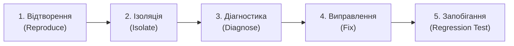

# Журнал налагодження (Debugging Log)

> **Лабораторна робота 6:** Тестування та налагодження  
> **Роль:** Керівник налагодження – Ізоляція помилок та виправлення (Debugging Lead)  
> **Виконавець:** Данііл Чернявський ([@megatr4n](https://github.com/megatr4n))  
> **Проєкт:** Платформа студентських оголошень НаУКМА (*Baraholka NaUKMA*)  
> **Дата:** 21 жовтня 2026 р.

---

## 1. Огляд челенджу налагодження («Зламай, потім відлагодь»)

У межах інтерактивного челенджу з налагодження кодова база була перевірена на стійкість обробки граничних і некоректних запитів фільтрації каталогу оголошень.

Було виявлено та відтворено критичний логічний дефект у фільтрації за ціною: **відсутність міжпараметричної валідації для інвертованого діапазону цін (`min_price > max_price`)**, коли клієнт передає некоректний інтервал (наприклад, `min_price=200` та `max_price=100`).

### Наслідки дефекту:
- **Тихий збій (Silent Failure):** Запит із суперечливим діапазоном не відхилявся як некоректний, а проходив через незалежні фільтри `price >= 200` та `price <= 100`, повертаючи статус `HTTP 200 OK` зі значенням `[]`.
- **Погіршення UX клієнта:** Користувач або фронтенд отримували повідомлення «Оголошень не знайдено» замість попередження про некоректно введені межі діапазону, що маскувало помилку користувацького введення під легітимний стан бази даних.

---

## 2. Систематичний процес налагодження (5 етапів)



### Етап 1: Відтворення помилки (Reproduce)
- **Дія:** Виконано HTTP-запит до каталогу з інвертованим інтервалом цін:
  ```http
  GET /api/v1/listings?min_price=200&max_price=100 HTTP/1.1
  Host: localhost:8000
  ```
- **Фактична поведінка:** API повернуло статус `HTTP 200 OK` з порожнім масивом `[]`.
- **Очікувана поведінка:** Інвертований діапазон є логічно суперечливим (порожня множина за визначенням через помилку клієнта). Сервер має детерміністично відхилити такий запит із кодом `HTTP 422 Unprocessable Content` (Validation Error) зі стандартизованим масивом `detail` у форматі `HTTPValidationError`, щоб клієнт міг оперативно виправити введення.
- **Створення регресійних тестів для фіксації відтворення:**
  1. [`test_list_public_rejects_inverted_price_range`](../../tests/test_listing_service.py) – фіксує обов'язковість генерації винятку `InvalidPriceRangeError` на рівні сервісу при `min_price > max_price`.
  2. [`test_catalog_rejects_inverted_price_range`](../../tests/test_listings_api.py) – фіксує статус `HTTP 422` та структуру масиву `detail` з розташуванням `["query", "min_price"]`.

### Етап 2: Ізоляція несправності (Isolate)
- **Аналіз шару контролерів ([`src/api/routers/listings.py`](../../src/api/routers/listings.py)):**
  Перевірено декларативні обмеження FastAPI:
  `min_price: Optional[float] = Query(None, ge=0)`
  `max_price: Optional[float] = Query(None, ge=0)`
  Обидва параметри мають лише індивідуальні обмеження невід'ємності (`ge=0`). Оскільки `200 >= 0` та `100 >= 0`, обидва значення незалежно проходять валідацію FastAPI.
- **Аналіз сервісного шару ([`src/services/listings.py`](../../src/services/listings.py)):**
  У методі `list_public` фільтрація виконувалася послідовними незалежними виразами:
  ```python
  if min_price is not None:
      items = [item for item in items if item.price >= min_price]
  if max_price is not None:
      items = [item for item in items if item.price <= max_price]
  ```
  Жоден компонент системи не перевіряв інваріант відношення між `min_price` та `max_price`.

### Етап 3: Діагностика першопричини (Diagnose)
1. **Коренева причина 1 (Відсутність реляційної валідації):** Декларативні валідатори окремих параметрів FastAPI не мають доступу до зв'язку між різними полями запиту. У бізнес-сервісі `ListingService` була відсутня перевірка взаємної узгодженості цінових меж `min_price <= max_price`.
2. **Коренева причина 2 (Невідповідність контракту помилок API):** Згідно з архітектурним документом [`docs/api/api-design.md`](../../docs/api/api-design.md) (рядки 87–98), помилки валідації `422` повинні повертати структурований масив об'єктів із полями `loc`, `msg` та `type`. Роутер повинен коректно публікувати цю схему (`HTTPValidationError`) в OpenAPI-специфікації.

### Етап 4: Виправлення (Fix)
Згідно з принципами Clean Architecture:
1. **Доменний шар ([`src/domain/exceptions.py`](../../src/domain/exceptions.py)):**
   Оголошено новий доменний виняток:
   ```python
   class InvalidPriceRangeError(ListingError):
       """Мінімальна ціна фільтрації перевищує максимальну ціну."""
   ```
2. **Сервісний шар ([`src/services/listings.py`](../../src/services/listings.py)):**
   Виділено приватний валідаційний метод:
   ```python
   @staticmethod
   def _validate_price_range(min_price: float | None, max_price: float | None) -> None:
       if min_price is not None and max_price is not None and min_price > max_price:
           raise InvalidPriceRangeError(
               f"min_price ({min_price}) не може перевищувати max_price ({max_price})"
           )
   ```
   Метод викликається на початку `list_public(min_price, max_price)`.
3. **Рівень API ([`src/api/routers/listings.py`](../../src/api/routers/listings.py)):**
   Уніфіковано трансляцію доменної помилки у функції `_raise_domain`:
   ```python
   if isinstance(exc, InvalidPriceRangeError):
       raise HTTPException(
           status_code=status.HTTP_422_UNPROCESSABLE_CONTENT,
           detail=[
               {
                   "loc": ["query", "min_price"],
                   "msg": str(exc),
                   "type": "value_error",
               }
           ],
       )
   ```
   Оголошено схеми `HTTPValidationError` і `ValidationErrorDetail` у [`src/api/schemas/listings.py`](../../src/api/schemas/listings.py) та оновлено специфікацію [`docs/api/openapi-generated.yaml`](../../docs/api/openapi-generated.yaml).

### Етап 5: Запобігання повторенню (Prevent Recurrence / Regression Testing)
Розроблено та верифіковано автоматизовані тести:
1. **Модульний тест доменного сервісу** у [`tests/test_listing_service.py`](../../tests/test_listing_service.py):
   - [`test_filter_by_price_range`](../../tests/test_listing_service.py) – підтверджує фільтрацію валідного інтервалу.
   - [`test_list_public_rejects_inverted_price_range`](../../tests/test_listing_service.py) – гарантує викид `InvalidPriceRangeError` при прямому виклику бізнес-логіки.
2. **Інтеграційний API-тест** у [`tests/test_listings_api.py`](../../tests/test_listings_api.py):
   - [`test_catalog_rejects_inverted_price_range`](../../tests/test_listings_api.py) – гарантує повернення статусу `HTTP 422` та валідацію полів `loc`, `msg`, `type` у списку `detail`.

---

## 3. Детальний аналіз дефекту

### Симптом (Symptom)
Клієнт передає параметри пошуку з інвертованим інтервалом (наприклад, фільтр ціни від 200 до 100 грн). Сервер відповідає `200 OK` зі значенням `[]`.

Користувач бачить стан «Товарів не знайдено» замість підказки про те, що нижня межа ціни перевищує верхню. Дефект ускладнює налагодження клієнтських застосунків і погіршує UX маркетплейсу.

### Причина (Cause)
Декларативні валідатори FastAPI `Query(ge=0)` інспектують кожну змінну окремо й не мають доступу до зв'язку між полями. У сервісі `ListingService` цінові фільтри накладалися незалежними умовами без попереднього контракту узгодженості інтервалу `[min_price, max_price]`.

### Порівняння коду

#### До виправлення:
```python
# src/services/listings.py
def list_public(self, ..., min_price: float | None = None, max_price: float | None = None, ...):
    items = [item for item in self._repository.list_all() if item.is_public()]
    if min_price is not None:
        items = [item for item in items if item.price >= min_price]
    if max_price is not None:
        items = [item for item in items if item.price <= max_price]
    ...
```

#### Після виправлення:
```python
# src/services/listings.py
def list_public(self, ..., min_price: float | None = None, max_price: float | None = None, ...):
    self._validate_price_range(min_price, max_price)
    items = [item for item in self._repository.list_all() if item.is_public()]
    if min_price is not None:
        items = [item for item in items if item.price >= min_price]
    if max_price is not None:
        items = [item for item in items if item.price <= max_price]
    ...

@staticmethod
def _validate_price_range(min_price: float | None, max_price: float | None) -> None:
    if min_price is not None and max_price is not None and min_price > max_price:
        raise InvalidPriceRangeError(
            f"min_price ({min_price}) не може перевищувати max_price ({max_price})"
        )
```

Регресійні тести:
- [`tests/test_listing_service.py::test_filter_by_price_range`](../../tests/test_listing_service.py)
- [`tests/test_listing_service.py::test_list_public_rejects_inverted_price_range`](../../tests/test_listing_service.py)
- [`tests/test_listings_api.py::test_catalog_rejects_inverted_price_range`](../../tests/test_listings_api.py)

### Уроки на майбутнє (Lessons Learned)
1. **Фільтри діапазонів завжди потребують реляційної перевірки:** Будь-які парні параметри (`min/max`, `start_date/end_date`, `from/to`) обов'язково повинні перевірятися на коректність інтервалу.
2. **Fail Fast & Explicit Errors:** Тиха обробка логічно некоректних даних (silent failure із поверненням `[]`) є антипатерном, оскільки маскує помилки клієнта під легітимний стан «дані відсутні».
3. **Регресійне тестування як гарантія якості:** Жодне виправлення дефекту не вважається завершеним без автоматизованого регресійного тесту, який спершу відтворює збій, а після виправлення стабільно проходить.

---

## 4. Бонусне завдання: Property-Based тестування інваріантів фільтрації (Hypothesis)

Для забезпечення абсолютної надійності виправленого цінового фільтра було впроваджено тестування на основі властивостей (Property-Based Testing) за допомогою бібліотеки `hypothesis` у [`tests/test_properties.py`](../../tests/test_properties.py).

- **Формулювання властивості (Property Invariant):**  
  > *Для будь-яких псевдовипадково згенерованих цін `min_price` та `max_price`, якщо `min_price <= max_price`, каталог повертає виключно ті активні оголошення, ціна яких потрапляє в закритий інтервал `[min_price, max_price]`; якщо ж `min_price > max_price`, система детерміністично відхиляє запит помилкою `InvalidPriceRangeError` незалежно від будь-яких числових значень.*

- **Результати тестування:**  
  Інструмент Hypothesis генерує 50 різноманітних комбінацій значень (екстремальні нульові ціни, дробові границі, рівні значення `min_price == max_price`, інвертовані пари), перевіряючи фундаментальний математичний інваріант системи без ручного підбору тестових даних.

---

> ### Нотатка «Використання ШІ»
> - **Інструменти:** Google Antigravity / Gemini 2.5 Pro.
> - **Етап:** Аналіз крайових умов фільтрації, формулювання 5 систематичних кроків налагодження, проєктування доменного винятку, нормалізація відповіді 422 у OpenAPI та розробка тестів Hypothesis.
> - **Що згенеровано:** Структура журналу налагодження `debugging-log.md`, шаблони доменного винятку `InvalidPriceRangeError`, нормалізація формату `detail` для FastAPI, тест властивостей `test_property_price_filter_invariant`.
> - **Що перевірено / відкинуто вручну:**
>   - Реалізовано нормалізацію структури відповіді HTTP 422 до стандарту OpenAPI `detail: list[dict]` замість одинарного рядка.
>   - Усі посилання в документі замінено на відносні шляхи репозиторію для повної портативності.
>   - Повний набір тестів (41 тест, 100% pass) перевірено локально через pytest, статичний аналіз верифіковано через Flake8, Black та Bandit.
